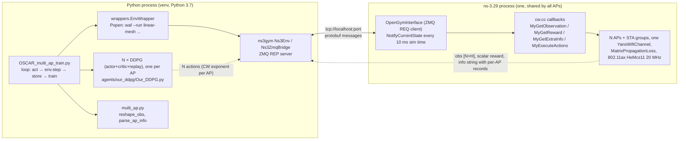

# REVIEW2_IMPLEMENTATION_STATE.md — Technical audit of `sohanroy676/mac-world` for Review 2

Audit date: 2026-11-01. Auditor: Claude (static code and evidence audit). Audience: a second AI assistant that will help prepare the Review 2 presentation.

## 0. How to read this document (scope, method, limits)

**What was inspected (fact).** Git objects of `origin/main` (`7df8322`) and `origin/dev` (`0b8606f`), read with `git show`, `git diff`, `git log`, `git ls-tree`. Source files read line by line: `ns-3.29/scratch/linear-mesh/cw.cc` (1483 lines on dev), `scenario.h`, `OSCAR_multi_ap_train.py`, `OSCAR_train.py`, `wrappers.py`, `multi_ap.py`, `agents/our_ddpg/{Our_DDPG,TD3,central,utils,preprocessor}.py`, and the ns3-gym C++ and Python bridge (`contrib/opengym/model/opengym_interface.cc`, `ns3gym/ns3env.py`). Docs read: `ROADMAP.md`, `docs/results/{baseline-v0.1.0,validation-v0.9.0,core-v1.0.0,benchmark-v1.1.0,final-results-v2.2.0,per-ap-scenario-v3.4.0}.md`, `docs/reports/{final-audit-v2.5.0,presentation-v2.4.0}.md`, `docs/reference/pre_v0.1.0_audit/OSCAR-forensic-audit-2026-09-15.md`, `docs/adr/0005-coarse-loss-matrix.md`, `sessionPrompt.md`.

**What was NOT done (fact).**
- ns-3 was **not built and no simulation or training was executed** in this audit. This container has no `ns-3.29/build` and no `ns-3.29/venv`. Every statement of the form "X works" below is based on (a) the code, and (b) recorded results committed in the repo. It is not a fresh run.
- One independent check was done: committed `trace.csv` files under `ns-3.29/scratch/linear-mesh/results/multi-ap-*/` were re-aggregated with a small read-only Python script (Mbps = mean of per-step `rx` over steps ≥ 300 × 1464 B × 8 / 0.01 s / 1e6, summed over APs). Results are in §10.3.
- The upstream OSCAR repository (`raoulraft/OSCAR-contention-window-RL`) was **not** fetched and diffed. Statements about the original OSCAR code come from the repo's own forensic audit (`docs/reference/pre_v0.1.0_audit/OSCAR-forensic-audit-2026-09-15.md`) and from `OSCAR_train.py`, which is still in the tree. They are labelled accordingly.
- Branch tips other than `main` and `dev` were only listed (§2.4), not code-audited.

**Labels.** *fact* = read in code or committed output. *recorded* = documented result in a committed file that I did not re-execute. *inference* = my reasoning. *unknown* = could not be determined.

**Line numbers** refer to `origin/dev` at `0b8606f` unless a branch is named. File paths are relative to the repo root; `LM/` below means `ns-3.29/scratch/linear-mesh/`.

---

## 1. Executive Summary

1. **The repo is much further along than the v1.0.0 target.** `dev` (273 commits, tip 2026-11-01) contains the full v0.3.0 to v1.0.0 chain **and** scaling to 10 APs (v1.2–v1.6), a central-critic prototype with a negative result (v1.7–v1.9), robustness runs, a technical report and a final audit (v2.x), shared-parameter agents (v3.0), a static-CW ceiling sweep (v3.1), a fair evaluation protocol (v3.2), IdleSense sensing (v3.3), and a hidden-node chain scenario with a proportional-fair reward (v3.4). `main` is frozen at 2026-10-27 (178 commits) and stops at v3.0.0-era content. Unmerged v4 / v3.5.0 work exists on `feature/v4` and sibling branches (§2.4). **If Review 2 is scoped to v1.0.0, the repo already exceeds that scope; the risk is claiming too much, not too little.**
2. **v1.0.0 is real in code.** One ns-3 process builds N APs with separate STA groups and per-AP counters (`cw.cc:976-1097`, `:640-700`). Each AP has its own CW (`setApCw`, `cw.cc:228-239`). A joint action vector sets one CW per AP (`cw.cc:344-386`). The trainer creates one DDPG actor, critic and replay buffer per AP (`OSCAR_multi_ap_train.py:181-185`). Recorded `--check` runs verify per-AP observation, reward and CW every step (`docs/results/validation-v0.9.0.md`). I did not re-run them.
3. **The learning result is weak, and this is the most important thing to know.** In the final benchmark at `20,40` STAs (150 Mbps per STA, n = 3 seeds), independent per-AP DDPG is **−5.6 ± 76.0 %** vs standard backoff (CI includes zero), while a single global-CW agent (OSCAR-style, one CW for all APs) is **+33.0 ± 29.0 %** (`docs/results/final-results-v2.2.0.md` §2.1, *recorded*). At 4 to 10 APs the independent agents are clearly worse than BEB (e.g. −46.2 ± 12.2 % at 10 APs, fixed 60 STAs). The central-critic prototype was also worse than independent (v1.9.0). Do not present independent agents as an improvement over BEB or over OSCAR.
4. **One non-learning heuristic matches the learned global agent.** On `20,40` with 8 paired seeds, IdleSense (no learning) gives 38.77 Mbps vs Global-CW 38.65 Mbps (paired +0.11 ± 0.25, p = 0.31). I re-aggregated the committed IdleSense and BEB traces and got 38.77 and 27.66 Mbps, matching the docs (§10.3).
5. **Where per-AP agents do show a benefit (recorded, narrow):** the hidden-node chain `10,10,10 --apHidden 1-3`. With a *shared team* proportional-fair reward (`--reward pf`, which deliberately relaxes AP isolation, ADR-0005), independent agents lift the starved middle AP from 1.44 to 9.99 Mbps (n = 8 paired seeds), at a cost of 8.8 Mbps in aggregate throughput. This is one policy seed; the follow-up policy seeds show the exact ordering is not stable (`per-ap-scenario-v3.4.0.md` §4c-§4d, §4i).
6. **Architecture facts that differ from the intended design:** (a) the observation is **one scalar** (newest per-step "loss" ratio) although 300 history values are transmitted; (b) "loss" is `(PhyTx − Rx)/PhyTx` where PhyTx counts every frame transmitted on the PHY including ACKs and beacons, so it is a proxy, not a collision rate (`cw.cc:140`, `:547`); (c) the default reward is local goodput normalised by offered load, so it is tiny under saturation (observed means 0.003 to 0.07); (d) **agents are not cooperative in the core v1 path** — cooperation only appears in opt-in variants (`--reward pf`, `--alpha`, `--mode shared`, `--mode central`), all of which relax the isolation rule; (e) all APs share one collision domain by default (`cw.cc:952`), so AP spacing in the topology has no effect on contention.
7. **Metrics gaps.** Implemented and measured on `dev`: aggregate and per-AP throughput, per-AP PHY loss proxy, per-AP Jain index, CW per AP, reward, actor and critic losses. **Not implemented on `dev`:** collision rate, retransmission count, packet delivery ratio from MAC ACK statistics, latency/delay, queue statistics. (Delay statistics exist only on unmerged `feature/v4`.) The original C++ `jain_index()` has uninitialised variables (`cw.cc:164-165`), and the legacy logger labels the loss ratio "Current Collision Rate"; the multi-AP Jain values are recomputed in Python and in `reportPerApStats`.
8. **Review 2 readiness:** the multi-AP system, per-AP isolation checks, benchmarks and the hidden-node scenario can be defended with committed evidence. The "robust and generalisable" framing is **a plan, not a result** (§16). A live demo must be a ~35 s, 3 s-simulation run; full runs take 14 to 18 minutes at 60 STAs and are never run live (`presentation-v2.4.0.md`).

---

## 2. Repository and Branch Overview

### 2.1 Branch tips

| | `main` | `dev` |
|---|---|---|
| Tip commit | `7df83222dbf65e18d9e2e9cd44e2d5610178183b` | `0b8606f63be26d91ace2524e26a22f8c52cbb354` |
| Message | `Merge branch 'docs/memory-final-state'` | `docs(changelog): regenerate with git-cliff` |
| Date | 2026-10-27 15:44 +0530 | 2026-11-01 09:33 +0530 |
| Commits reachable | 178 | 273 |
| Relationship | 0 commits that `dev` lacks | 95 commits ahead of `main`, 0 behind |
| Root commit | `bc6f12c` 2026-09-16 `docs(design): define multi-ap v0.2.0` (both) | same |

`main` is an ancestor of `dev` (fact, `git rev-list --count origin/dev..origin/main` = 0). `CLAUDE.md` and `sessionPrompt.md` declare `main` frozen and `dev` the integration branch.

### 2.2 Differences between `main` and `dev` (fact, `git diff --stat origin/main origin/dev`)

23 files differ (1860 insertions, 89 deletions), excluding run data:

| Area | Only on `dev` (or changed) |
|---|---|
| ns-3 | `cw.cc` 1245 → 1483 lines: `--apHidden`, `--hiddenLoss`, `--apLoads`, `--cwMinOnly`, `--idleSense` and related flags, `--residual`, `--obsIdle`, AP-radio idle-slot tracing (`cw.cc:616-634`). `scenario.h` 1 line. |
| Python | `OSCAR_multi_ap_train.py` 409 → 497 lines (`--mode static/idlesense`, `--reward pf`, `--algo td3`, `--varySeeds`, `--saveActor/--loadActor/--eval`); new `agents/our_ddpg/TD3.py`, `ceiling_sweep_v3_1_0.py`, `fair_protocol_v3_2_0.py`. |
| Docs | ADR-0005, `docs/results/{ceiling-v3.1.0,fair-protocol-v3.2.0,sensing-heuristics-v3.3.0,per-ap-scenario-v3.4.0}.md`, `docs/research-beat-oscar.md`, technical report §20.x additions, `sessionPrompt.md`, memory-bank updates. |
| Run data | `results/` has 205 tracked files on `main` and 1724 on `dev`; `_actor` model files: 0 on `main`, 63 on `dev`. |

Grep check (fact): `main`'s `cw.cc` contains no occurrence of `apHidden`, `idleSense` or `cwMinOnly`.

### 2.3 Which branch is most complete

`dev`. It is a strict superset of `main`. `main` lacks everything from v3.1.0 onward. Tags v3.1.0, v3.3.1 and v3.4.0 are ancestors of `dev` but not `main`.

### 2.4 Unmerged branches (fact, `git rev-list --count origin/dev..<branch>`)

All of these exist on `origin`. Counts are commits not in `dev`.

| Branch | Ahead of dev | Tip | Content (from commit subjects only; code not audited) |
|---|---|---|---|
| `feature/v4` | 26 | `e38fee8` 2026-11-01 | Integration of the v4 plan and v3.5.0 work |
| `feature/v3.5.0-cw-flags` | 19 | `c014edc` | `useRts`, `rewardNorm`, `extraTraces` flags in `cw.cc` |
| `feature/v3.5.0-onoff-pool` | 21 | `5fccc96` | `staSchedule`, `scenarioPool`, delay stats |
| `feature/v3.5.0-adrs-analysis` | 23 | `7af8ad9` | GC tables, ADR-0006/0007, scenario pool |
| `feature/v3.5.0-lanes-port` | 17 | `5ed507c` | unseeded free ports, unique run dirs |
| `fix/lane-leftover-check` | 25 | `d5446d6` | per-run leftover check, floor slack |
| `claude/project-thread-p80xpo` | 15 | `aa1d85c` | v4 plan document revisions |
| `claude/project-thread-inm5oa`, `-rjopz9`, `-fbdl9g` | 1 each | — | literature survey, research plan, novelty check (docs only) |
| `release/v2.8.2` | 22 | `1d24948` | Tag `v2.8.2` is on this line; not reachable from `main` or `dev` |

`git diff --stat origin/dev origin/feature/v4` over `ns-3.29/scratch` (excluding `results/`) touches 7 files, +598/−13: `cw.cc` (+123), `OSCAR_multi_ap_train.py`, new `gc_analysis.py`, `scenarios/pool_v3_5_0.json`, `scenario.h`, `wrappers.py`, `multi_ap.py`. *Inference:* this is v4-plan (robustness / generalisation) groundwork, not part of v1.0.0.

I found no uncommitted work to inspect (a cloud checkout has none). Work that exists only on a user's laptop is **unknown**.

### 2.5 Tags (fact, `git tag -l`)

Present: `v0.3.0` (`d7541ef`) through `v3.4.1`, plus `v3.3.1` (`e279b9d`, 2026-11-01), `main-at-v3.4.1`. **Missing from this repo: `v0.1.0` and `v0.2.0`.** `ROADMAP.md` says v0.1.0 is tagged "on `major-project`" and no branch of that name exists on origin. `CLAUDE.md` says pre-existing tag references in older docs are obsolete. Tag `v2.8.2` exists but points at `release/v2.8.2`, which is neither merged to `main` nor `dev`.

### 2.6 Directory structure (relevant parts)

```
ROADMAP.md  CLAUDE.md  AGENTS.md  CHANGELOG.md  sessionPrompt.md  memory-bank/
docs/{planning,design,adr,results,reports,reference,figures}/
ns-3.29/                       pristine ns-3.29 (src identical to nsnam release per final-audit §3)
  contrib/opengym/             ns3-gym, byte-identical to tkn-tub/ns3-gym a9ee83b74 (final-audit §3)
  scratch/linear-mesh/         PROJECT CODE
    cw.cc  scenario.h          ns-3 scenario, gym callbacks
    OSCAR_train.py             original single-AP OSCAR trainer (kept)
    OSCAR_multi_ap_train.py    multi-AP trainer, all modes
    wrappers.py  multi_ap.py   process launcher; per-AP info parsing and metrics
    agents/our_ddpg/           Our_DDPG.py, TD3.py, central.py, utils.py, preprocessor.py, loggers.py
    agents/ddpg/               CCOD agent (inherited, not on the OSCAR path)
    benchmark_v1_1_0.py aggregate_bench.py scaling_analysis.py ceiling_sweep_v3_1_0.py fair_protocol_v3_2_0.py ...
    results/                   run dirs (config.json + trace.csv), logs, saved actors (force-added on dev)
bake/ netanim-3.108/ pybindgen-*/ build.py ...   upstream ns-3-allinone files
```

---

## 3. Actual System Architecture



### 3.1 How ns-3 is used (fact)

- A single ns-3 program `linear-mesh` (`LM/cw.cc` + `scenario.h`) is launched by the trainer through `waf --run "linear-mesh --key=value ..."` (`wrappers.py:48-54`). One process simulates all APs together.
- Simulated time advances in lock-step with Python: every `envStepTime` (default `0.01` s in the multi-AP trainer, `OSCAR_multi_ap_train.py:28`) ns-3 pauses and exchanges one state/action pair.

### 3.2 Topology (fact)

- `--apStaCounts a,b,c` creates `len` APs and `a`, `b`, `c` STAs (`parseApStaCounts`, `cw.cc:816`; `set_phy`, `:949-974`; `set_nodes`, `:976-1097`). The number of APs is a runtime parameter, not hard-coded. Without the flag the program is a single AP with `--nWifi` STAs (the original OSCAR setup).
- Each AP gets SSID `oscar-ap-<i+1>`; its STAs associate to that SSID (`cw.cc:1001-1017`). Association is by SSID with `ActiveProbing=false`. Since every AP hears every STA (below), correct association relies on SSID match; `reportAssociation` (`cw.cc:1184-1221`) checks `wrongAp`, `unassociated` and de-association counts.
- Positions: AP *i* at x = 50·*i* m, STAs in rows near their AP (`cw.cc:1026-1040`). **This geometry does not drive the radio model** (next point).

### 3.3 Channel sharing (fact)

- One `YansWifiChannel` is created once and used by every PHY (`cw.cc:964-969`). The propagation loss is `MatrixPropagationLossModel` with `SetDefaultLoss(50)` (`cw.cc:952`) and **no per-pair loss by default**. Every node therefore hears every other node at 50 dB loss regardless of position. All APs share one channel and, by default, one collision domain.
- With `--apHidden a-b`, all node pairs between BSS *a* and BSS *b* get `--hiddenLoss` dB (default 200 dB) via `SetLoss` (`cw.cc:1047-1058`). This is an all-or-nothing BSS-level matrix (ADR-0005). There is no partial overlap, no distance-based path loss, no per-AP channel number.

### 3.4 Traffic, MAC, PHY (fact)

- Standard `WIFI_PHY_STANDARD_80211ax_5GHZ` (`cw.cc:1355`), `ConstantRateWifiManager` with `HeMcs11` for data and control (`:1357-1360`; `mcs=11` at `:1235`), 20 MHz, guard interval 800 ns (`:1237-1238`). No rate adaptation. RTS/CTS off (`useRts=false` at `:1233`; the enabling branch at `:1336` is dead code on `dev`). STA A-MPDU size 0 (`:1006`).
- Traffic is **uplink only**: each STA runs an `OnOffApplication` (constant rate, UDP, 1464-byte payload, ToS `0x70` = AC_BE) to a `UdpServer` on its own AP, one port per STA starting at 1025 (`scenario.h:151-193`, `BasicScenario::installScenario` `:245-259`). Default offered load 150 Mbps per STA (saturated); `--offeredLoad` and `--apLoads` change it.
- Contention, collisions, backoff and retransmissions are handled by ns-3's own 802.11 MAC (`DcaTxop`/`QosTxop`). The project code does not implement MAC logic; it only writes `MinCw`/`MaxCw` attributes and reads trace sources.

### 3.5 Intended vs actual architecture

| Intended design item (from task text) | Actual (code) | Status |
|---|---|---|
| Each AP has its own independent RL agent | `--mode independent` creates `n` DDPG objects, each with own actor, critic, optimizers and replay (`OSCAR_multi_ap_train.py:181-185`) | **Implemented** |
| Each agent observes its AP's local state | State = that AP's newest own loss (`local_states`, `:154-159`); `--check` recomputes it from the AP's own counters (`:329-339`) | **Implemented** (1 scalar) |
| Independent AP-specific CW action | Joint vector → `setApCw` per AP (`cw.cc:344-386`) | **Implemented** |
| No direct communication between agents | True in `independent` default. **Violated by opt-in variants:** `--reward pf` (same team reward to all agents), `--alpha < 1` (network goodput mixed into reward), `--mode shared` (one shared network), `--mode central` (shared critic) | **Core path holds; variants relax it (ADR-0004, ADR-0005)** |
| Shared NS-3 environment | One ns-3 process, one channel | **Implemented** |
| Decentralised, no central critic in v1 | Central critic exists but is optional and was a negative result (`central.py`, v1.9.0) | **Holds** |
| "Cooperative deep RL" (project title) | Not part of the v1 core. Only the PF reward variant and the central critic are cooperative, and neither beat the simple baselines in general | **Title overstates v1** |

---

## 4. NS-3 Implementation Audit

| Function | Source | What the code does | Status |
|---|---|---|---|
| AP / STA creation | `cw.cc:949-974` `set_phy` | Creates `Σ counts` STA nodes and `len(counts)` AP nodes; one shared channel | Complete |
| Association | `cw.cc:976-1022` `set_nodes` | Per AP: STAs get `StaWifiMac(Ssid=oscar-ap-i, ActiveProbing=false, MaxMissedBeacons=10)`; AP gets `ApWifiMac` with beacon jitter when >1 AP | Complete |
| Wi-Fi standard, PHY, rate | `cw.cc:1355-1360`, `:1231-1238` | 802.11ax 5 GHz, HeMcs11 constant rate, 20 MHz, GI 800 ns | Complete (fixed values) |
| IP and ARP | `cw.cc:1059-1073`, `scenario.h` `PopulateARPcache` | 192.168.1.0/24, static ARP cache, global routing | Complete |
| Traffic apps | `scenario.h:151-193`, `:245-259` | One OnOff source per STA, one UdpServer sink per STA on the AP | Complete |
| Simulation duration | `cw.cc:1141` `set_sim` | `Simulator::Stop(simTime + end_delay + 1.0 + step·(H+1))` (`:1141`); flow monitor starts after 1 s warm-up (`:1103`) | Complete |
| Throughput (aggregate) | `cw.cc:588-592`, `:1405-1406`; `reportPerApStats` `:764-814` | Counts `UdpServer` Rx trace events; Mbps = packets × 1464 × 8 / elapsed | Complete |
| Throughput (per AP) | `cw.cc:599-602`, `:640-700` | Per-AP Rx counter bound to the sinks hosted on that AP | Complete |
| Loss (per AP) | `cw.cc:547`, `:764-814` | `loss_phy = (PhyTx − Rx)/PhyTx`; `loss_app = (AppTx − Rx)/AppTx`. PhyTx counts **all** `PhyTxBegin` of the AP and its STAs including ACKs and beacons (`:140`, `:679`) | Implemented; **a proxy, not collision rate** |
| Collision / retransmission stats | — | No counter. `grep -i -E "retry|retrans|collision|MacTxDataFailed"` finds only comments and CLI help text | **Missing** |
| Queue stats | — | None | **Missing** |
| Delay / latency | — | None on `dev` (delay stats appear on unmerged `feature/v3.5.0-onoff-pool`) | **Missing on dev** |
| Per-flow Jain / FlowMonitor | `cw.cc:158-181`, `:1429-1450` | `FlowMonitor` per-flow Mbps printed at the end; Jain over flows | Partial; `jain_index()` has uninitialised locals (`:164-165`), documented as known quirk #1 in `baseline-v0.1.0.md` §7 |
| Per-AP Jain | `cw.cc:752-762` `jainFromValues`, `multi_ap.py:129-133` | Jain over per-AP throughput | Complete |
| Per-AP bookkeeping check | `cw.cc:764-814` | Checks sink Rx equals the per-AP counter, `rx ≤ appTx`, totals equal the sum of APs; prints `Per-AP statistics check: PASS/FAIL` | Complete |
| Association diagnostics | `cw.cc:1148-1221` | First-association time, `wrongAp`, `unassociated`, `deassoc` per AP | Complete |
| Idle-slot sensing | `cw.cc:616-634` | AP radio `State` trace → idle slots between busy periods (used only with `--idleSense`/`--obsIdle`) | Complete (v3.3.0) |
| Hidden pairs | `cw.cc:702-750`, `:1050-1060` | Loss matrix and "frames heard" diagnostic matrix | Complete (v3.4.0) |
| Seeding | `cw.cc:1343-1346` | `RngSeedManager::SetSeed` before any node exists (fix from v1.1.0, commit `0e71414`) | Complete |

---

## 5. Multi-AP Topology

| Question | Answer (evidence) |
|---|---|
| How are APs instantiated? | `wifiApNode.Create(apStaCounts.size())`, one `ApWifiMac` device per AP (`cw.cc:970-972`, `:1011-1017`) |
| Does each AP have its own STA group? | Yes. `apStaNodes[i]` holds the STAs of AP *i* (`cw.cc:984-1000`) |
| Can STA counts differ per AP? | Yes. e.g. `20,40`, `5,55`, `5,5,5,45` (configs used in `final-results-v2.2.0.md`) |
| AP-specific identifiers | Index *i*, SSID `oscar-ap-i`, BSS container `g_apBss[i]` (AP first, then its STAs) (`cw.cc:1075-1081`), "Gym map" log line (`:1387-1391`) |
| Per-AP attribution of packets and statistics | Yes: Rx via sinks on AP *i*; PhyTx via the PHYs of AP *i* and its STAs; AppTx via the OnOff sources of AP *i*'s STAs (`cw.cc:640-700`) |
| Do APs contend over the same medium? | Yes, by default every node hears every node (`cw.cc:952`). With `--apHidden`, listed BSS pairs are isolated from each other |
| One simulation or many? | One simulation, all APs together (the trainer launches one `linear-mesh` process, `wrappers.py`) |
| Hidden-node / challenging topologies | One: `10,10,10 --apHidden 1-3` (BSS1 and BSS3 cannot hear each other; BSS2 hears both). Validated by a "Hidden-pair check" (`per-ap-scenario-v3.4.0.md` §1) |
| AP count configurable? | Yes, no hard-coded limit found in code. Documented runs go up to 10 APs (220 STAs, `scaling-v1.5.0.md`, *recorded*) |

**The three milestones the task asks to keep separate (fact):**

1. *A topology that creates multiple APs:* implemented (v0.3.0, `cw.cc:976-1097`).
2. *A topology that measures each AP independently:* implemented (v0.4.0, `cw.cc:599-700`, `:764-814`). Per-AP reward and loss are also computed in `recordHistory` (`:540-550`).
3. *A topology that allows each AP to make independent CW decisions:* implemented (v0.5.0, `setApCw`; v0.6.0 joint action vector, `MyExecuteActions`). Independence of *learning* is a separate Python-side milestone (v0.7.0).

**Caveat on per-AP isolation (fact).** Isolation here is of *accounting and decisions*, not of the *radio medium*: because all nodes hear each other, one AP's CW changes its neighbours' throughput by construction. `validation-v0.9.0.md` Test A records that AP2's Rx rose from 126 to 320 when AP1 backed off. That is the intended contention coupling, not a leak.

**Known multi-AP issues (fact).**
- Late association and de-association bursts at large STA counts when traffic starts at t = 0 (`final-audit-v2.5.0.md` row "10 AP works": full-size dry association check FAILS; cause traced to traffic start plus MaxMissedBeacons, n = 1; the diagnostic flags `--trafficStart`, `--staMaxMissedBeacons` exist).
- In the first 1 s the MinCw/MaxCw are 0/0 unless set; for multi-AP runs `set_nodes` starts at BEB values 16/1024 (`cw.cc:1088-1097`, fix from commit `1306e37`, v2.0.0).

---

## 6. Contention Window Optimization

| Question | Answer |
|---|---|
| Who selects the CW? | The Python agent for each AP (modes `independent`, `shared`, `central`), one agent for all APs (`global`), or an ns-3 rule (`--dryRun` BEB, `--idleSense`, `--apCws` static) |
| Per-AP CW? | Yes. `g_apCwMin[i]`, `g_apCwMax[i]` (`cw.cc:55-56`); `setApCw` writes the AP and every STA of BSS *i* only (`:228-239`) |
| Action representation | Continuous scalar per AP. Actor output a ∈ [−1, 1] (tanh × `max_action=1`, `Our_DDPG.py:33`). Python maps to `real = 6·(a+1)/2` ∈ [0, 6] (`OSCAR_multi_ap_train.py:297`). C++ computes `CW = 2^(4 + real)` (`cw.cc:366`) and clamps to [16, 1024] (`:377`) |
| Valid CW values | Not restricted to powers of two: any real exponent gives an integer CW in [16, 1024] after truncation. `--agentType direct_continuous` (CW given directly) exists but the trainer always passes `continuous` (`:103`) |
| How applied | `Config::Set(".../BE_Txop/$ns3::QosTxop/MinCw")` and `MaxCw` for every node in the BSS (`cw.cc:222-239`). Default: `MinCw = MaxCw = CW` (**pinned CW, no exponential doubling**, same as OSCAR). `--cwMinOnly` sets MaxCw = max(cw, 1023) to keep BEB doubling (`:380`) |
| Effective CW at STAs | STAs overwrite their BE CW from the AP's EDCA parameter set, which carries `2^ECW − 1`. A written CW of 16 gives 15 at the STAs and 1024 gives 1023. The readback check accepts the exact value or the rounded value (`edcaRoundedCw`, `cw.cc:243-251`; `checkApCw`, `:257-305`) |
| Updated when? | Every `envStepTime` (10 ms) during the simulation, not only between episodes (`MyExecuteActions` is called from `NotifyCurrentState`, `opengym_interface.cc:284`) |
| Verification | `checkApCw` reads back MinCw/MaxCw from each node at t = 0, after warm-up and at the end; `periodicCwReadback` for diagnostics; `--check` compares the readback with the expected CW every step (`OSCAR_multi_ap_train.py:320-327`) |
| BEB baseline | `--dryRun`: CW set to 16/1024 once and never changed (`cw.cc:1089-1090`) |
| Initial CW | Warm-up actions are random in [−1, 1] for the first `start_timesteps` = 300 steps (`OSCAR_multi_ap_train.py:282-283`) |
| Follows OSCAR? | Same action space and CW mapping, same pinned CWmin = CWmax, same range [16, 1024]. Differences are listed in §11 |

**Limitations (fact).** Only the BE access category is controlled. The CW for ACK/beacon/management frames is untouched. A single CW applies to all STAs of an AP (no per-station CW). Because `CW=16` is applied to MinCw directly, the BEB baseline and the lowest learned CW use 16 where the standard's BE default is 15/1023 (the STA-side rounding turns 16 into 15; the AP keeps 16).

---

## 7. Reinforcement Learning Implementation

### 7.1 Algorithm (fact)

- **DDPG** (re-tuned, Fujimoto-style) in `LM/agents/our_ddpg/Our_DDPG.py`. TD3 (`TD3.py`, subclass of DDPG with twin critics, delayed actor, target smoothing) is an option (`--algo td3`). `central.py` is a MADDPG-style CTDE variant. **There is no MADDPG in the default path.** The default `independent` mode is N independent DDPG learners, i.e. independent-learners MARL.

### 7.2 Network and hyper-parameters (fact)

| Item | Value | Source |
|---|---|---|
| Actor | 1 → 128 → 128 → 1, ReLU, tanh output × `max_action` (1) | `Our_DDPG.py:14-33` |
| Critic | (state+action) 2 → 128 → 128 → 1, ReLU | `Our_DDPG.py:36-52` |
| State dim, action dim | 1 and 1 (`--obs loss`); 4 with `--obs hist` | `OSCAR_multi_ap_train.py:91`, `:140` |
| Discount γ | 0.7 | `Our_DDPG.py:56`; trainer `--discount` default `:34` |
| Soft update τ | 1e-3 | `Our_DDPG.py:56`, `:104-108` |
| Learning rates | actor 4e-4, critic 4e-3 (Adam) | `Our_DDPG.py:59`, `:63` |
| Batch size | 32 | trainer `--batch_size` `:32` |
| Replay | per agent, ring buffer, capacity 1e6, uniform sampling | `utils.py:5-31` |
| Exploration | Gaussian noise σ = 0.1 added to the actor output; first 300 steps are uniform random actions in [−1, 1] | trainer `:33`, `:282-288` |
| Updates per step | one gradient update per agent per environment step after warm-up | `:352-353` |
| Target networks | yes, both actor and critic, soft-updated | `Our_DDPG.py:57-65`, `:104-108` |
| Device | CUDA if available else CPU | `Our_DDPG.py:8` |
| Episode / steps | `--simTime` 15 s / `--stepTime` 0.01 s → 1500 steps; `--episodes` default 1; the first 300 steps are random-action warm-up | trainer `:27-31`, `:90` |
| Model save / load | `DDPG.save/load` (`Our_DDPG.py:111-126`); trainer `--saveActor DIR`, `--loadActor DIR --eval` for frozen evaluation (`:58-60`, `:416-420`). Original `OSCAR_train.py --save_model` only creates a directory; it never calls `policy.save` (`OSCAR_train.py:87`, `:99`) |
| Seeding | `torch.manual_seed`, `np.random.seed` (`:99-100`); ns-3 seed = `--seed` + 1 (`:104`; ns-3 rejects seed 0); `--varySeeds` changes the ns-3 seed per episode (`:151`) |

### 7.3 Multi-agent structure (fact, per mode)

| Question | `independent` (default, v0.7–v1.0) | `global` | `shared` | `central` |
|---|---|---|---|---|
| Number of agents | N (one per AP) | 1 | 1 network used by all N APs (one replay with N rows per step) | N actors + 1 critic object |
| Independent actors | Yes | n/a | No (one shared actor) | Yes (separate actors) |
| Independent critics | Yes (local critics) | n/a | No | No: one shared critic Q(s_joint, a_joint) |
| Replay buffers | N separate | 1 | 1 shared | 1 joint buffer |
| Observation | own newest loss (local) | network loss (Σtx−Σrx)/Σtx (**global**) | own loss (local) | own loss at execution; joint state for the critic in training |
| Reward | own goodput / (own load × own STAs × step), clamped [0, 1] (local) | network goodput / (all load), (**global**) | own goodput, or PF or α-mix | global goodput (**global**) |
| Agents communicate? | No | n/a | No explicit messages; share weights | No messages; share critic in training |
| Training / execution | Decentralised / decentralised | n/a | centralised weights / decentralised | CTDE |
| Code | `:278-288`, `:306-312`, `:352-353` | `:291-296`, `:356-374` | `:354-355` | `:375-390`, `central.py` |

Reward code (fact):
- Per-AP reward, computed in ns-3: `cw.cc:548-550`: `goodputMbit = rxDelta·(1500−20−8−8)·8/1e6`; `r = goodputMbit / (load_per_STA · nSTAs · envStepTime)`; clamped to [0, 1].
- PF team reward: `pf_reward`, `OSCAR_multi_ap_train.py:213-216`: `1 + mean_i log(1e-3 + r_i) / −log(1e-3)`, clamped to [0, 1]; the same value goes to all agents when `--reward pf` (`:304`, `:311`).

**Statement that is true and safe to make:** the default `independent` mode is *N independent DDPG learners with local observations, local rewards and local critics*. It is not MADDPG and not cooperative. **If an agent in a variant receives a team reward (`--reward pf`, `--alpha < 1`) it is no longer isolated**; the repo labels such results "relaxed" (ADR-0004, ADR-0005).

### 7.4 Isolation tests (recorded, `--check`)

`OSCAR_multi_ap_train.py --check` asserts every step: distinct parameter pointers per agent (`:229-234`), distinct replay buffers, replay row equals the (state, action, next state, reward) just computed (`:313-318`), CW readback equals the intended CW (`:320-327`), observation equals the AP's own `(tx−rx)/tx` (`:329-339`), reward equals the recomputed formula (`:340-342`), no leftover ns-3 process (`:490-491`), W&B history equals logged metrics (`:447-480`), episode reset behaviour (`:481-489`). These checks live in the same script that produces the values, so they are consistency checks; they do not independently prove the model is learning well.

---

## 8. NS-3 / Python Communication

### 8.1 Cycle (fact; verified against code, not by execution)

1. Python `EnvWrapper.__init__` starts `waf --run "linear-mesh --key=val ... --openGymPort=P"` in a subprocess (`wrappers.py:36-37`, `:48-54`) and creates `Ns3Env(port=P, startSim=0, ...)`, which binds a ZMQ **REP** socket (`ns3env.py:40`). Port P = `13968 + i + randint(40000)` (`wrappers.py:19`).
2. ns-3 connects as ZMQ **REQ** client (`opengym_interface.cc:81`, `:163-164`), sends the init message (spaces) and later state messages.
3. `OpenGymInterface::NotifyCurrentState()` (`:214`) is scheduled by `ScheduleNextStateRead` every `envStepTime` (`cw.cc:505-509`). It calls `GetObservation()`, `GetReward()`, `IsGameOver()`, `GetExtraInfo()` (the callbacks in `cw.cc`), serialises them and **sends** (`:257-259`).
4. It then **blocks on `recv`** for the action message (`:263-264`), calls `ExecuteActions` (`:284`) and returns. Simulation proceeds for the next 10 ms.
5. Python `env.reset()` receives the first state with no action (`ns3env.py:405-420`). `env.step(action)` does `send_actions` then `rx_env_state` (`:227-230`), i.e. it replies to the pending state and waits for the *next* state, which reflects the 10 ms after the action was applied.
6. The trainer parses per-AP records from the `info` string (`multi_ap.py:111-123`), builds replay tuples and trains (`OSCAR_multi_ap_train.py:299-353`).

So the intended sequence (observe → decide → send → apply → advance → reward and next observation → learn) **is** the implemented sequence. The reward returned with state *k+1* is the AP's goodput over the 10 ms *after* action *k*.

### 8.2 Interfaces

| Item | Value | Source |
|---|---|---|
| Observation space | Box [0, 10], shape `(H,)` single AP or `(N, H)` for N>1 APs, float32. `H=historyLength` (300 in the trainer) | `cw.cc:97-114` |
| Action space | Box [0, 10], shape `(1,)` or `(N,)`, float32. Values used: 0 to 6 | `cw.cc:116-134` |
| Observation content | Per AP, the last H per-step loss ratios, newest first (or idle-slot mean/20 with `--obsIdle`). **The trainer uses only element 0** (`local_states`, `:154-159`; `S_rows[:, :1]`) | `cw.cc:460-497`, `:511-586` |
| Scalar reward (gym) | Mean of per-AP rewards when N>1. **Not used by the trainer** | `cw.cc:423-428` |
| Per-AP info string | `sentMb|CW|active|jain|` then per AP `cwSet,cwReadback,reward,loss,rxDelta,phyTxDelta,idleMean` separated by `;` | `cw.cc:184-220`; parsed in `multi_ap.py:111-123` |
| Done flag | `MyGetGameOver()` always false; episodes end when Python has taken `steps_per_ep` steps and closes the env (`cw.cc:499-503`; trainer `:398-415`) |
| Process start | `EnvWrapper` also supports `no_threads>1` ports, but only one env is used |

### 8.3 Compatibility issues and workarounds (fact)

- ns-3 rejects `--seed=0` → trainer passes `seed+1` (`:104`).
- `EnvWrapper.observation_space/action_space` parse the `repr()` of the space with string operations (`wrappers.py:77-85`); fragile. The multi-AP trainer does not use them.
- `EnvWrapper.__getattr__` calls `env.attr()` (`wrappers.py:95-97`): looks like a bug; not reached in the observed flow (*inference*).
- Gym 0.26.2 is installed while `ns3env.py` implements the old Gym API (`reset` returns obs only, `step` returns 4 values). Works because the project calls `ns3env` directly (*inference from usage*).
- `opengym` tree is byte-identical to upstream commit `a9ee83b74` (final-audit §3, *recorded*).
- The ns-3 process sits blocked in the ZMQ exchange after the last Python step, so code after `Simulator::Run()` in `main()` (the `cw.csv` dump and the final per-AP print) does not run in the training flow (`baseline-v0.1.0.md` §7 item 5; the per-step trace in `trace.csv` is therefore the authoritative output).
- One ns-3 job at a time: the leftover check uses `pgrep -x linear-mesh`; a concurrent job causes a false failure (`validation-v0.9.0.md` §2).

---

## 9. Reward Function and Metrics

### 9.1 Reward (fact)

| Mode | Formula | Local or global | Source |
|---|---|---|---|
| single AP (original OSCAR) | `Mbit_per_step × 10 / (5·150·step)`; reset to last value if outside [0, 1] | global | `cw.cc:423-450` |
| multi-AP `independent` (default) | `clamp( goodputMbit_i / (load_i · nSTA_i · step), 0, 1)` | local per AP | `cw.cc:548-550` |
| `global` | `clamp( Σ goodput / (Σ load·nSTA · step), 0, 1)` | global | `OSCAR_multi_ap_train.py:204-207` |
| `--alpha a` | `a·own + (1−a)·network` | mixed | `:311` |
| `--reward pf` | PF function of all APs' normalised goodputs | team | `:213-216`, `:304` |
| `central` | global goodput for the critic; local reward stored separately | global | `:375-379` |

Throughput is the only quantity in the reward. **Packet loss, fairness (except through PF), collision penalties and delay are not in the default reward.** Because it is normalised by offered load, a saturated network (150 Mbps per STA) yields rewards near zero: recorded policy-phase reward means were 0.032 / 0.069 for `2,3` and 0.041 / 0.003 for `5,15` (`validation-v0.9.0.md` §3). *Inference:* small reward magnitudes combined with γ = 0.7 give the critic a weak signal; this was not tested.

Rewards are logged per step in `trace.csv` (column `reward`) and in W&B (`AP<i>/Reward`).

### 9.2 Metric status

| Metric | Status | Where |
|---|---|---|
| Aggregate throughput | Implemented and measured | `cw.cc:588`, `:764-814`; `multi_ap.py:136-150` |
| Per-AP throughput | Implemented and measured | `cw.cc:599`, `:764-814` |
| Packet delivery ratio (app-level) | Implemented as `1 − loss_app` (AppTx vs sink Rx), printed by `reportPerApStats` at the end of `main()`. That print is reached with `--dryRun`/`--disableGym`; in the gym training flow it is *probably not reached* (inference from `opengym_interface.cc:276-278` calling `std::exit(0)` on the stop request, and `baseline-v0.1.0.md` §7 item 5). The per-step `rx`/`tx` columns in `trace.csv` give the same quantity in the training flow | `cw.cc:764-814` |
| PHY-level "loss" | Implemented, but defined as `(PhyTx−Rx)/PhyTx` including ACK and beacon transmissions: **a proxy** | `cw.cc:547` |
| Collision rate | **Not present as a measurement.** The legacy single-AP logger logs the metric named "Current Collision Rate" but its value is `states[0]`, i.e. the newest per-step loss ratio (`agents/our_ddpg/loggers.py:97`). It is the loss proxy under another name. Do not present it as a collision rate | `loggers.py:97` |
| Retransmission count | **Not present** | — |
| Jain fairness (per AP) | Implemented and measured (Python, and `jainFromValues` in C++) | `multi_ap.py:129`, `cw.cc:752` |
| Jain fairness (per flow, legacy) | Implemented but **not valid**: uninitialised variables. The legacy logger logs it as "Fairness index" (`loggers.py:95,105`, from info field 4) | `cw.cc:158-181` |
| Latency / delay | **Not present on dev** | — |
| Queue length | **Not present** | — |
| CW per AP | Implemented and measured (set + readback) | `cw.cc:184-220` |
| Convergence step | Computed offline in analysis scripts (rolling-100 within ±5 % of last-300 mean) | `aggregate_bench.py`, `benchmark-v1.1.0.md` §4 |
| PF utility, min-AP throughput | Implemented in analysis (`--pf`) | `aggregate_bench.py`, `per-ap-scenario-v3.4.0.md` |
| Statistical tests | Mean ± 95 % CI (Student t), paired differences, Wilcoxon implemented in `aggregate_bench.py` (no scipy) | `sessionPrompt.md` item 2 |

---

## 10. Experimentation, Logging and Results

### 10.1 Experiment scripts and logging

| Script | Purpose |
|---|---|
| `OSCAR_multi_ap_train.py` | Main trainer. Modes `independent global beb central shared static idlesense` |
| `benchmark_v1_1_0.py` | Resumable matrix runner (topology × mode × seed), manifest CSV |
| `ceiling_sweep_v3_1_0.py` | Static per-AP CW grids (no learning) |
| `fair_protocol_v3_2_0.py` | Train 2 episodes, save actors, frozen noise-free evaluation at seeds 100-107 |
| `aggregate_bench.py`, `scaling_analysis.py`, `summarize_run.py`, `load_sweep.py` | Tables and figures |
| `baseline_v0_1_0.py`, `baseline_beb.py` | Single-AP OSCAR freeze, BEB baseline |
| `test_multi_ap_gym.py` | Deterministic joint-action gym test |
| `wandb_sync_final.py` | Sync final offline runs to W&B |

- **Logging:** per-step `trace.csv` (17 columns: episode, step, ap, state, action, real_action, reward, next_state, cw_set, cw_ap, loss, rx, tx, pp_mean, pp_std, actor_loss, critic_loss) and `config.json` per run (`OSCAR_multi_ap_train.py:167-174`); W&B offline by default (`:70-71`), 19 keys per step (`AP<i>/{CW,Reward,Throughput,LossRatio,Observation,ActorLoss,CriticLoss,CumulativeReward}`, `Global/{Throughput,Fairness,LossRatio,CumulativeReward}`, `Episode`, `Step`). **No TensorBoard.** W&B online sync is documented as PARTIAL in `final-audit-v2.5.0.md` (9 tracked `.wandb` files are offline copies).
- **Trained models:** 63 `*_actor` files tracked on `dev` under `results/fair-*` (frozen-eval arms), 0 on `main`.

### 10.2 Recorded results (not re-run; source file named)

All numbers are Mbps over the policy window (steps ≥ 300) unless stated. Single episode of 15 s unless stated. "n" = seeds.

| Result | Value | Source |
|---|---|---|
| v1.0.0, `2,3`, one run, whole-run BEB vs policy-phase | BEB 43.47 vs trained 40.34 (window mismatch, later fixed) | `core-v1.0.0.md` §3 |
| v1.1.0 `2,3` n=3 | BEB 40.47 ± 0.09, Global 40.41 ± 0.69, Independent 39.98 ± 0.90 | `benchmark-v1.1.0.md` §3 |
| v1.1.0 `5,15` n=3 | BEB 34.48 ± 0.48, Global 37.95 ± 5.51, Independent 33.57 ± 12.92 | same |
| Final set (fixed binary, v2.0.0 `*-cwfix`), `20,40`, 150 Mbps/STA, n=3 | BEB 27.30 ± 0.63; Global 36.29 ± 7.16 (+33.0 ± 29.0 %); Independent 25.78 ± 20.80 (−5.6 ± 76.0 %) | `final-results-v2.2.0.md` §2.1 |
| Fixed 60 STAs, N = 2/4/6/10 APs, n=3 | Independent vs BEB: +3.8, −27.0, −35.8, −46.2 % | `final-results-v2.2.0.md` §2.2 |
| Imbalance `5,55`, `5,5,5,45` | Independent −5.4 ± 36.2 %, −16.2 ± 17.3 % | §2.3 |
| Load sweep `20,40` (0.5 / 1 / 150 Mbps per STA) | Independent +3.5 ± 13.3 %, −58.8 ± 50.3 %, −5.6 ± 76.0 % | §2.4 |
| Central critic vs independent, N = 10 | −5.80 ± 10.48 Mbps (CI includes 0); rule not met | `ROADMAP.md` v1.9.0 |
| `20,40` n=8 paired seeds 100-107, frozen eval | BEB 27.66, Global-CW 38.65, IdleSense (published rule, no learning) 38.77 (paired vs Global +0.11 ± 0.25, p = 0.31); best static CW 39.62 | `memory-bank/activeContext.md` 2026-11-01, `sensing-heuristics-v3.3.0.md` §3c |
| Hidden chain `10,10,10 --apHidden 1-3`, n=8, frozen | BEB 71.63 (per-AP 34.95/1.44/35.24); Global 76.46; independent `--alpha 0` 68.77; independent `--reward pf` 62.82 with middle AP 9.99; shared `--reward pf` 73.43 | `per-ap-scenario-v3.4.0.md` §4 |
| Same, other policy seeds | PF-arm ordering and "matches oracle" claims **do not hold across policy seeds**; TD3 / cwMinOnly seed-0 rankings reverse at seed 1 | `per-ap-scenario-v3.4.0.md` §4c, §4d, §4h, §4i |
| IdleSense on the chain | Highest aggregate 78.12 but middle AP 0.53 Mbps | `memory-bank/activeContext.md`, `sensing-heuristics-v3.3.0.md` §3b |

**Reproducibility (recorded):** two full `2,3` runs with the same seed gave all 17 `trace.csv` columns identical (0 differing lines of 3001), including losses (`core-v1.0.0.md` §2). Scope: same machine, one seed. A closeout rerun on a rebuilt binary differed by 0.2 % in summary (40.40 vs 40.34); cause not investigated.

### 10.3 Independent re-aggregation from committed traces (this audit)

| Check | Re-computed from `results/multi-ap-*` | Doc value | Match |
|---|---|---|---|
| Hidden chain, frozen eval, Global (8 runs) | 76.46 | 76.46 | exact |
| Hidden chain, frozen eval, independent `--alpha 0` (8 runs) | 68.77 | 68.77 | exact |
| `20,40`, BEB, eval seeds 100-107 (8 runs) | 27.66 | 27.66 | exact |
| `20,40`, IdleSense, seeds 100-107 (8 runs) | 38.77 | 38.77 | exact |
| `20,40`, BEB, 4 committed runs seeds 0,1,2,100 | 27.31 | final-results 27.30 (3 seeds) | different run set, close |
| `20,40`, Global, 3 committed runs seeds 0,1,2 | 36.17 | final-results 36.29 | different run set, close |
| `20,40`, independent, 5 committed runs (v1.1.0 batch, pre-CW-fix) | 25.27 | final-results 25.78 (cwfix) | different run set, close |

**Finding (fact):** the exact `bench-v2.0.0-*-cwfix` run directories behind the headline `final-results-v2.2.0.md` table are described there as "local, not committed". The committed traces reproduce the later n = 8 results exactly and the earlier ones approximately. Treat the v2.2.0 table as *recorded, source runs not in the repo*.

### 10.4 Other facts

- Experiment outputs **are** committed on `dev` (460 `trace.csv` + `config.json`, 63 saved actors, manifests, logs, 1724 files under `results/`), although `.gitignore`, `CLAUDE.md` and the README still say run directories are local only. The files were force-added with user approval (memory-bank). This is a documentation inconsistency (§14).
- No trained model is needed for BEB, IdleSense or static arms (no learning).
- Number of APs and STAs used: 1 AP/40 STAs (baseline); `2,3`, `5,15`, `20,20`, `20,40` (core); 4/6/8/10 APs up to 220 STAs (scaling); `5,55`, `5,5,5,45` (imbalance); `10,10,10 --apHidden 1-3` (hidden chain); `6×10` (static reference).
- Traffic: saturated 150 Mbps per STA UDP uplink in almost all experiments; 0.5 and 1 Mbps in the load sweep; `--apLoads 150,150,20` and `150,150,1` in the uneven-load checks (the first still saturated AP3, i.e. not informative).
- Training: 1 episode × 1500 steps (v1.x), 2 episodes (frozen-eval protocol), 300 random-action warm-up steps. Measurements in v1.x include exploration noise; frozen noise-free evaluation exists only from v3.2.0.

---

## 11. Comparison with the Original OSCAR

**Sources.** `OSCAR_train.py` (kept in the tree, single AP), the repo's forensic audit (2026-09-15) of the inherited code, `docs/reference/oscar-baseline-metrics.md`. The upstream repo was not diffed here.

| Aspect | Original OSCAR (as inherited) | This repo |
|---|---|---|
| Algorithm | DDPG ("OurDDPG"), 128×128 actor/critic, γ = 0.7, τ = 1e-3, batch 32, noise 0.1 | **Retained unchanged** (`Our_DDPG.py`), plus TD3 option |
| Topology | 1 AP, `nWifi`=40 STAs | **Retained** when `--apStaCounts` is empty; **extended** to N APs in one process |
| State | one scalar, newest loss (of a 300-value history) | **Retained**, per AP |
| Action → CW | a∈[−1,1] → `6(a+1)/2` → `2^(4+·)` → clamp [16,1024], MinCw = MaxCw | **Retained**; applied per AP (`setApCw`); optional `--cwMinOnly` |
| Reward | `Mbit×10/(5·150·step)`, hard-coded 5·150 | **Retained** for single AP. **New:** per-AP reward normalised by that AP's real offered load |
| CW application | one wildcard `Config::Set` to all Wi-Fi devices | **Modified:** per-BSS paths (`cw.cc:222-239`) |
| Env wrapper, ns3-gym | `EnvWrapper`, ns3-gym `app` branch | **Retained**; multi-AP obs/action shapes added |
| Logging | W&B online + legacy Logger | **Extended:** offline W&B, per-AP keys, `trace.csv`, `config.json` |
| Seeding | `--seed` had no effect on ns-3 (found in v1.1.0, fixed `0e71414`) | **Fixed** |
| New in this project | — | multi-AP topology and stats, per-AP CW and readback, independent agents, `global`/`shared`/`central`/`static`/`idlesense` modes, `--check` isolation tests, hidden-pair scenario, PF reward, frozen evaluation, TD3, IdleSense |
| Not done | — | The 300-sample history is still reduced to 1 value by default (`--obs hist` option exists); known quirks of the inherited code (uninitialised Jain, `sentMbytes` in Mbit) were left unchanged |

**What is a technical difference but not (by itself) a research contribution:** per-AP bookkeeping, seeding fix, logging, isolation tests. **What is the substantive extension:** a multi-AP contention environment with per-AP CW control, plus the finding (recorded) that independent local-reward agents do not beat a single global CW agent in the one-collision-domain setting.

---

## 12. Version-wise Implementation Status

Classification rule used: *Completed and verified* = code present on `dev` **and** recorded validation committed in the repo; none of these were re-executed here. Tags are the annotated tag target commits.

| Version | Intended milestone | Classification | Evidence |
|---|---|---|---|
| v0.1.0 | Reproduce and freeze single-AP OSCAR baseline | **Implemented but not fully verified** | `docs/results/baseline-v0.1.0.md`; `OSCAR_train.py`, `baseline_v0_1_0.py`. The full 3-episode reproduction was stopped by the user during episode 2; only episode-1 numbers recorded (§9 of that doc). **Tag `v0.1.0` is not present in this repo.** |
| v0.2.0 | Multi-AP design | **Completed** (documentation deliverable) | `docs/design/multi-ap-design-v0.2.0.md`, `docs/adr/0002-*`; root commit `bc6f12c`. **Tag `v0.2.0` not present.** |
| v0.3.0 | Two-AP topology | **Completed and verified (recorded)** | tag `v0.3.0` = `d7541ef`; `cw.cc:976-1097`; association/per-AP checks PASS on `2,3 / 5,15 / 20,20 / 20,40` (`validation-v0.9.0.md` Test C) |
| v0.4.0 | Per-AP statistics | **Completed and verified (recorded)** | tag `3837c37`; `cw.cc:599-700`, `:764-814` ("Per-AP statistics check: PASS") |
| v0.5.0 | AP-specific CW | **Completed and verified (recorded)** | tag `392cdaf`; `setApCw`, `checkApCw`; Test B PASS |
| v0.6.0 | Multi-AP ns3-gym | **Completed and verified (recorded)** | tag `8e720d6`; `(N,H)` observation, `(N,)` action, info string; `test_multi_ap_gym.py` |
| v0.7.0 | Independent AP-level DDPG | **Completed and verified (recorded)** | tag `3a6a59e`; trainer `:181-185`, `--check` PASS (disjoint params, replays) |
| v0.8.0 | Experiment logging | **Implemented but not fully verified** | tag `fe4ba69`; offline W&B logging verified (19 keys, 1500 rows). Online sync untested for the final runs (`final-audit-v2.5.0.md` "W&B works: PARTIAL") |
| v0.9.0 | Validation | **Completed with scope note** | tag `2b1bce0`; Tests A to F PASS on short runs; long runs only `2,3`, `5,15` at that tag (20,20 and 20,40 done at v1.0.0) |
| v1.0.0 | Complete two-AP multi-agent OSCAR | **Completed and verified as a working, reproducible system; performance claim not supported** | tag `v1.0.0` = `0b7bfd9`; `core-v1.0.0.md`: identical traces from two seeded runs, BEB comparison on `2,3`, `5,15`, `20,20`, `20,40`. Trained independent agents were below BEB on `20,20` (30.0 vs 32.2, one seed) and above on `20,40` (32.3 vs 29.2, one seed, whole-run window mismatch); later n=3 and n=8 results show no reliable gain |

Beyond the requested table (all with tags, not in the Review 2 target): v1.1–v1.6 benchmarks and scaling (Global-CW +26 to +41 %, independent worse, CIs wide); v1.7–v1.9 central critic design, prototype, evaluation (negative); v2.0–v2.5 robustness, reproducibility, final results, report, presentation, audit; v2.6–v2.7 reward-scale and follow-ups; v3.0–v3.4.1 improvement attempts (neutral), ceiling, fair protocol, IdleSense, hidden-chain scenario. v3.5.0 and v4 are unmerged.

---

## 13. Build and Execution Instructions

Verified from `README.md`, `CLAUDE.md`, `LM/README.md`, `sessionPrompt.md`. **Not executed in this audit.**

- **OS:** Ubuntu 22.04 on WSL2 (README, CLAUDE.md). Other OS: unknown.
- **Versions (pinned, per CLAUDE.md):** ns-3.29 (C++, GCC 11.4), ns3-gym 1.0.0 / Python package 0.1.0, Python 3.7.16 in `ns-3.29/venv`, PyTorch 1.13.1+cu117, Gym 0.26.2, NumPy 1.21.6, protobuf 3.20.3, pyzmq 26.2.1, W&B 0.18.7. GPU: GTX 1650 Ti 4 GB (optional; CPU works, *inference*: `Our_DDPG.py:8`).
- **No lock file or `requirements.txt` for the project's Python environment** (the only `requirements.txt` is inside the ns3-gym package). Reproducing the venv depends on the pinned list in `CLAUDE.md`.
- **Build:** `cd ns-3.29 && ./waf build --target=linear-mesh` (a stale binary is not validation; the docs require confirming the binary was rebuilt). Run target is `scratch/linear-mesh/linear-mesh`, not `cw`.
- **Dry run (no gym):** `./waf --run "scratch/linear-mesh/linear-mesh --dryRun=true --disableGym=true --apStaCounts=20,40 --simTime=2"`. A 2 s dry run at 60 STAs took >10 min on the first laptop (`validation-v0.9.0.md` §3).
- **Train:** `cd ns-3.29/scratch/linear-mesh && ../../venv/bin/python OSCAR_multi_ap_train.py --apStaCounts 20,40 --check` (default 15 s, 1500 steps). Other modes: `--mode global|beb|shared|static --apCws ...|idlesense`.
- **Baseline smoke:** `../../venv/bin/python baseline_v0_1_0.py --smoke` (original single-AP).
- **Regression numbers after any `cw.cc` change:** `--nWifi=5` dry seed 1 simTime 2 = 10533 packets; `--apStaCounts=5,15` = 9000; gym smoke 10.59458 (`sessionPrompt.md`).
- **Config / env vars:** `LM/config.py` holds the W&B entity (one line); `WANDB_ENTITY`, `WANDB_MODE` (offline by default) and `--online`. No secrets found in the files read.
- **Execution order:** build → regressions → trainer launches ns-3 itself → one ns-3 job at a time (parallel jobs trip the leftover-process check).
- **Run times (recorded):** `2,3` 15 s run 3 m 46 s; `5,15` 8 m 33 s; 60-STA runs 842 to 1054 s; hidden chain 430 to 545 s; BEB job about as long as a learned job because ns-3 dominates.
- **Known issues:** `git push` over HTTP/2 may fail with HTTP 408 → `git -c http.version=HTTP/1.1 push` (`sessionPrompt.md`); WSL timing is erratic (3 to 26 min per job in one batch, `benchmark-v1.1.0.md` §4). No CI exists (no `.github/`).
- **Outdated instruction found:** the README says "Raw run directories … are local only and not committed"; `dev` tracks them.

---

## 14. Known Issues and Limitations (ranked)

No *Critical* issue was found: nothing in the code prevents the intended v1.0.0 system from working, according to code reading and recorded runs. This is not a substitute for a fresh build and run.

| # | Severity | Issue | Evidence |
|---|---|---|---|
| 1 | **High** (validity of claims) | Independent per-AP agents do not beat BEB or Global-CW in the main benchmark and get worse with more APs; CIs are wide (n = 3) | `final-results-v2.2.0.md` §2 |
| 2 | **High** | Observation is one scalar and a PHY-level loss proxy that includes ACK/beacon transmissions; it is not a collision rate, and the agent sees nothing about contention (idle time, retries, active stations) | `cw.cc:140`, `:547`, trainer `:154-159` |
| 3 | **High** | Reward normalised by offered load is near zero under saturation; no fairness or delay term in the default reward; selfish local reward drives a CW race (documented diagnosis) | `validation-v0.9.0.md` §3, `docs/research-beat-oscar.md` |
| 4 | **High** | No collision, retransmission, delay or queue metrics on `dev`, so any statement about latency or collision reduction cannot be supported by this code | §4, §9 |
| 5 | **High** (framing) | The default topology is one collision domain; AP positions are cosmetic; "co-channel interference" is modelled only as all-hear-all or fully hidden | `cw.cc:952`, ADR-0005 |
| 6 | **Medium** | Headline v2.2.0 numbers come from run directories not in the repo; committed traces approximately match (§10.3) | `final-results-v2.2.0.md`, this audit |
| 7 | **Medium** | Policy-seed variance: PF-arm results and TD3 / cwMinOnly rankings change with the training seed. Only 1 to 3 policy seeds | `per-ap-scenario-v3.4.0.md` §4c-§4i |
| 8 | **Medium** | v1.x results include exploration noise and use one 15 s episode. Frozen noise-free evaluation exists only from v3.2.0 | §10.4 |
| 9 | **Medium** | `jain_index()` reads uninitialised locals (C++ undefined behaviour); it appears in field 4 of the info string, which the legacy single-AP logger records as "Fairness index", so that logged value is unreliable. The multi-AP trainer does not use it: it recomputes Jain from per-AP throughput (`multi_ap.py:129-150`) | `cw.cc:158-181`, `:197` |
| 10 | **Medium** | Association instability at large STA counts when traffic starts at t = 0; full-size 10-AP dry association check FAILS | `final-audit-v2.5.0.md` |
| 11 | **Medium** | Reproducibility is shown only for one seed on one machine; a closeout rerun differed by 0.2 %. CUDA is used if present and was not tested for bit-wise determinism | `core-v1.0.0.md` §2 |
| 12 | **Medium** | No project Python lock file; `wrappers.py` has fragile space parsing and an unusable `__getattr__` | §8.3, §13 |
| 13 | **Medium** | Cooperation is not in the v1 core; the project title says "Cooperative Deep RL" | §3.5 |
| 14 | **Low** | Missing tags `v0.1.0`, `v0.2.0`; `v2.8.2` unreachable from `main`/`dev` | §2.5 |
| 15 | **Low** | Docs inconsistent on whether run directories are committed; `CLAUDE.md` forbids committing `results/` while 1724 files are tracked | §10.4 |
| 16 | **Low** | 21 `[REF:key]` placeholders in the technical report (as of the v2.5.0 audit; some filled later, current count not checked) | `final-audit-v2.5.0.md` |
| 17 | **Low** | Inherited quirks: `sentMbytes` is Mbit, hard-coded `5·150`, original `OSCAR_train.py --save_model` saves nothing | `baseline-v0.1.0.md` §7, `OSCAR_train.py:87,99` |
| 18 | **Low** | `ConvergenceScenario` is single-AP only | `scenario.h:262-290` |
| 19 | **Unknown** | Whether the 10-AP and 220-STA runs are reproducible on another machine; the OSCAR paper's own numbers could not be reproduced in absolute terms (the paper reports relative gains only, `oscar-baseline-metrics.md`) | — |

Single-AP assumptions still in multi-AP code: the single-AP branch of `MyGetReward`, `MyGetObservation` and `MyExecuteActions` is kept alongside the multi-AP branch (`if (g_apBss.size() > 1)`), so the single-AP path is byte-compatible with the original (the docs record byte-identical regressions). No per-AP shared mutable state was found in the Python trainer; the `shared` mode shares weights by design.

---

## 15. Review 2 Readiness Assessment

**Scoping note.** The task statement sets v1.0.0 as the Review 2 implementation target. The repo is already past that point. A Review 2 on v1.0.0 should present v1.0.0 honestly and may present later work as additional evidence.

1. **What is genuinely implemented today:** a single ns-3.29 process with N APs, different STA counts per AP, per-AP statistics, per-AP CW with readback, a joint-action ns3-gym interface, N independent DDPG agents with isolation checks, per-AP and global logging, BEB / Global-CW / static / IdleSense baselines, a hidden-node chain scenario, and a frozen-evaluation protocol.
2. **What can be demonstrated live:** the 35 s rehearsed demo in `docs/reports/presentation-v2.4.0.md`: `OSCAR_multi_ap_train.py --apStaCounts 2,3 --mode independent --simTime 3 --stepTime 0.1 --historyLength 20 --start_timesteps 10 --batch_size 8 --check` (rehearsal 2026-10-19: 32.7 s, `RESULT: PASS | steps: 30`, per-AP CWs differ on every logged step). **Requires a working build and venv, which this container lacks.** It shows mechanics only, not the benchmark result.
3. **What can be supported with logs / screenshots:** committed figures in `docs/figures/` (v1.1.0 to v2.2.0 and v3.x), results tables, committed `trace.csv` files (re-aggregation script in §10.3), per-AP CW traces (`cw_traces.png`), the validation tests table, the hidden-chain tables.
4. **Still only design or plan:** robust / generalising single controller (v4 plan, `feature/v4` branches, not merged), delay and fairness-gap metrics, RTS/CTS, scenario pools, multi-AP baselines beyond IdleSense, any claim of generalisation to unseen scenarios.
5. **Three most important unfinished tasks:** (a) a learner whose observation carries contention information beyond one loss proxy, evaluated against strong baselines in more than one scenario; (b) delay / collision / retransmission instrumentation in `cw.cc` (partly on `feature/v3.5.0-onoff-pool`); (c) a reproducible, scripted environment (lock file, committed source runs for the headline table) and a clean merge of the pending feature branches.
6. **Minimum work to reach v1.0.0 as defined (2-AP, working, repeatable):** already met on the evidence above. The remaining step is to **re-run, on the demo machine,** the build, the regression numbers (10533 / 9000 / 10.59458) and the `2,3 --check` run, and to have the missing `v0.1.0` and `v0.2.0` tags added if tags are required.
7. **Claims to avoid:**
   - "Independent agents beat BEB / OSCAR" (−5.6 ± 76 % at `20,40`, worse with more APs).
   - "Cooperative multi-agent RL" for the default path (it is independent; cooperative variants are opt-in and relax isolation).
   - "MADDPG" (the default is independent DDPG; `central` is MADDPG-style and a negative result).
   - "Reduces collisions / retransmissions / latency" (no such metrics on `dev`).
   - "Models co-channel interference / spatial reuse / realistic dense deployments" (all-hear-all or fully hidden only).
   - "Robust" or "generalises to unseen scenarios" (no such experiment exists on `dev`).
   - "Fairness improvement" outside the hidden chain with the PF reward (and even there, with one policy seed per arm in the headline batch and a documented aggregate-throughput cost).
   - Absolute comparison with the OSCAR paper's Mbps (the paper gives relative gains only).
   - "Matches the static optimum" (not stable across policy seeds).

**Recommended demonstration sequence (using only what exists):**
1. Show §3 diagram and `ROADMAP.md` status.
2. `git tag` / `git log --oneline` to show milestones v0.3.0 to v1.0.0 (expect no `v0.1.0`/`v0.2.0`).
3. Dry run, 2,3 STAs, 2 s: shows association check, per-AP statistics check and per-AP CW check PASS lines.
4. The 35 s live trainer run with `--check` (above); point to `AP1 cw` vs `AP2 cw` differing per step and `RESULT: PASS`.
5. Show `trace.csv` columns and `AP<i>/` W&B keys.
6. Show `docs/figures/v2.2.0/main-20-40/` plots and the BEB / Global / Independent table, stating the −5.6 ± 76 % result plainly.
7. Show the hidden-chain table (§10.2) as the one place where per-AP agents help, with the 1.44 → 9.99 Mbps middle-AP change and the −8.8 Mbps aggregate cost and the policy-seed caveat.
8. Close with the open questions (§16).

---

## 16. Requirements for the Robustness Research Direction

*Proposed framing (not implemented):* **robust and generalisable contention-window optimisation in multi-AP Wi-Fi networks**, motivated by **co-channel interference and airtime contention in dense deployments**. Nothing in the repo shows robust generalisation today. The v4 plan (`feature/v4`, `claude/project-thread-p80xpo`) describes the intended experiment design; it is a plan.

Can the current `dev` architecture support the experiments? Assessment:

| Future experiment | Supported by `dev` today? | What must be added |
|---|---|---|
| Different numbers of APs | **Yes**: `--apStaCounts`, up to 10 APs run | Nothing for correctness; compute time is the limit (14 to 18 min per 60-STA job) |
| Different STA distributions | **Yes**: any counts per AP | Scenario pool / sampler (partly on `feature/v3.5.0-onoff-pool`, `scenarios/pool_v3_5_0.json`) |
| Unequal traffic loads | **Partly**: `--apLoads` (per-STA load per AP); saturated vs unsaturated checked | A true unsaturated, bursty or time-varying source (`staSchedule` on the unmerged branch). Note `--apLoads 150,150,20` was still saturated |
| Different contention conditions | **Partly**: STA count, load, one hidden-pair option | Partial-overlap or distance-based path loss, RTS/CTS (`useRts` flag is on an unmerged branch), more hidden topologies. ADR-0005's loss matrix is all-or-nothing |
| Hidden-node / challenging topologies | **Yes, one**: `--apHidden` (BSS-level) | More topologies, e.g. more than 3 BSSs, asymmetric hidden pairs, hidden stations inside a BSS (not possible with the BSS-level matrix) |
| Comparison with fixed-CW baselines | **Yes**: `--mode static --apCws`, `ceiling_sweep_v3_1_0.py` | A per-scenario best-static oracle for every scenario in the suite |
| Comparison with adaptive non-learning baselines | **Partly**: IdleSense (published rule) | PI controller, gradient-search PF, BLADE-like rule, Bianchi-based CW; the Bianchi source was not obtainable (`activeContext.md`) |
| Generalisation to scenarios not seen in training | **Mechanics yes, evidence no**: `--saveActor/--loadActor --eval` supports train-here / test-there | Training over randomised scenarios, held-out scenario list, an observation that does not depend on the AP count, per-scenario scoring |
| Observation with contention information | **Partly**: `--obsIdle` (idle slots) | Retry-bit, busy-time, active-station count (v4 plan), history window as input |
| Fairness-aware objective with defined constraints | **Partly**: `--reward pf` | Weighted / α-fair variants, explicit fairness floor, min-AP and Jain metrics in every table |
| Delay / tail-latency metrics | **No** | Per-packet delay in `cw.cc` (on `feature/v3.5.0-onoff-pool`), p95/p99 in analysis |
| Statistical protocol | Partly: paired seeds, CIs, Wilcoxon | Pre-registered analysis spec; multiple-comparison control (specified in the v4 plan, not implemented on `dev`) |
| Throughput of experiments | Poor: one ns-3 job at a time | Parallel lanes / ports (`feature/v3.5.0-lanes-port`) |

---

## 17. Recommended Next Implementation Steps

Ordered by value for a defensible Review 2:

1. **Re-validate on the presentation machine** (build, regression packet counts, `2,3 --check`). Fix any drift before anything else. *(½ day, no new code.)*
2. **Fix the `jain_index()` uninitialised variables** (or remove field 4 of the info string) and the inherited quirks that touch reported metrics. *(small, needs a deliberate baseline-value change note, as the docs themselves say.)*
3. **Add collision/retransmission and delay instrumentation** in `cw.cc` (reuse the work on `feature/v3.5.0-onoff-pool`), so claims about contention, retries and latency become testable.
4. **Decide the Review 2 scope in writing:** v1.0.0 as the implementation target, with the neutral / negative learning result stated as a finding, plus the hidden-chain case as a motivating scenario.
5. **Merge or retire the pending branches** (`feature/v4` and siblings) after review, so `dev` reflects the actual state; tag `v0.1.0` / `v0.2.0` only if the user wants them (tags need user approval per `CLAUDE.md`).
6. **Commit the source runs behind the headline table, or re-run it,** so `final-results-v2.2.0.md` can be reproduced from the repo.
7. **Robustness direction:** implement the scenario pool and held-out evaluation, add per-scenario static oracles and the non-learning baselines, then test one controller across the suite. Do this before using the words "robust" or "generalises".

---

## 18. Complete File Reference Index

### 18.1 Project code (`ns-3.29/scratch/linear-mesh/`)

| File | Role | Key lines |
|---|---|---|
| `cw.cc` (1483) | ns-3 scenario: gym callbacks, topology, per-AP CW, stats, IdleSense, hidden pairs | spaces `97-134`; `setApCw` `228`; `edcaRoundedCw` `243`; `checkApCw` `257`; `MyExecuteActions` `344`; `MyGetReward` `423`; `MyGetObservation` `460`; `recordHistory` `511`; `apPhyState` `616`; `connectPerApStats` `640`; `reportPerApStats` `764`; `set_phy` `949`; `set_nodes` `976`; `set_sim` `1100`; `reportAssociation` `1184`; `main` `1229` |
| `scenario.h` (289) | Traffic installation, ARP cache, `BasicScenario`, `ConvergenceScenario` | `installTrafficGenerator` `151`; `BasicScenario::installScenario` `245` |
| `OSCAR_multi_ap_train.py` (497) | Multi-AP trainer, all modes, `--check` | args `25-66`; agents `180-187`; loop `262-415`; checks `437-497` |
| `OSCAR_train.py` (199) | Original single-AP OSCAR trainer | — |
| `wrappers.py` (97) | `EnvWrapper`: spawns `waf --run`, ports | `19`, `36-54`, `77-85` |
| `multi_ap.py` (53) | `reshape_obs`, `parse_ap_info`, `jain`, `step_metrics` | `107-150` |
| `agents/our_ddpg/Our_DDPG.py` (126) | Actor, Critic, DDPG | `14-126` |
| `agents/our_ddpg/TD3.py` (67) | TD3 option | — |
| `agents/our_ddpg/central.py` (66) | CTDE central critic | `12-66` |
| `agents/our_ddpg/utils.py` (81) | `ReplayBuffer`, `JointReplayBuffer` | — |
| `agents/our_ddpg/preprocessor.py`, `loggers.py` | Logging-only windowing; legacy logger | — |
| `agents/ddpg/` | CCOD agent (inherited, off the OSCAR path) | — |
| `benchmark_v1_1_0.py`, `aggregate_bench.py`, `scaling_analysis.py`, `summarize_run.py`, `load_sweep.py`, `ceiling_sweep_v3_1_0.py`, `fair_protocol_v3_2_0.py`, `baseline_beb.py`, `baseline_v0_1_0.py`, `test_multi_ap_gym.py`, `test_oscar_connection.py`, `wandb_sync_final.py`, `CCOD_train.py`, `standard_test_and_ccod_train.py` | Experiment, analysis and test scripts | — |
| `config.py` (1) | W&B entity | — |

### 18.2 ns3-gym (`ns-3.29/contrib/opengym/`)

`model/opengym_interface.cc` (REQ socket `:81`, `NotifyCurrentState` `:214`, action receive `:263-284`), `model/opengym_env.cc`, `model/spaces.cc`, `model/messages.proto`, `model/ns3gym/ns3gym/ns3env.py` (REP socket `:40`, `step` `:227`, `reset` `:405`). Byte-identical to upstream commit `a9ee83b74` per `final-audit-v2.5.0.md`.

### 18.3 Documentation

| Area | Files |
|---|---|
| Plan, spec | `ROADMAP.md`, `docs/planning/{detailed_roadmap,project_description}.md`, `docs/research-beat-oscar.md` |
| Design, ADRs | `docs/design/{multi-ap-design-v0.2.0,central-critic-v1.7.0,central-critic-v1.8.0}.md`, `docs/adr/0001-0005` |
| Results | `docs/results/{baseline-v0.1.0,validation-v0.9.0,core-v1.0.0,benchmark-v1.1.0,scaling-v1.2.0..v1.6.0,central-eval-v1.9.0,robustness-v2.0.0,final-results-v2.2.0,improvement-v3.0.0,ceiling-v3.1.0,fair-protocol-v3.2.0,sensing-heuristics-v3.3.0,per-ap-scenario-v3.4.0}.md` |
| Reports | `docs/reports/{technical-report-v2.3.0,presentation-v2.4.0,final-audit-v2.5.0}.md` |
| Reference | `docs/reference/{oscar-baseline-metrics,reproducibility-v2.1.0}.md`, `docs/reference/pre_v0.1.0_audit/*` |
| Figures | `docs/figures/<version>/` (tables, CSV manifests, PNGs) |
| State | `memory-bank/{activeContext,progress,architecture,projectBrief,systemPatterns,tech-stack}.md`, `sessionPrompt.md`, `CLAUDE.md`, `AGENTS.md`, `CHANGELOG.md` |

### 18.4 Commits and tags cited

Branch tips: `main` `7df8322`, `dev` `0b8606f`, `feature/v4` `e38fee8`. Root `bc6f12c`. Tags: `v0.3.0` `d7541ef`, `v0.4.0` `3837c37`, `v0.5.0` `392cdaf`, `v0.6.0` `8e720d6`, `v0.7.0` `3a6a59e`, `v0.8.0` `fe4ba69`, `v0.9.0` `2b1bce0`, `v1.0.0` `0b7bfd9`, `v1.1.0` `da8d406`, `v2.2.0` `21009ba`, `v2.5.0` `8f5a257`, `v3.0.0` `cbdb0b5`, `v3.1.0` `04caa72`, `v3.4.0` `169cff3`, `v3.3.1` `e279b9d`. Code fixes: seed order `0e71414`; start-at-BEB-CW `1306e37`; hidden pairs `04d70ea`; `--cwMinOnly` `75b54cd`; sensing `f54c735`, IdleSense rule `0ef2481`.
