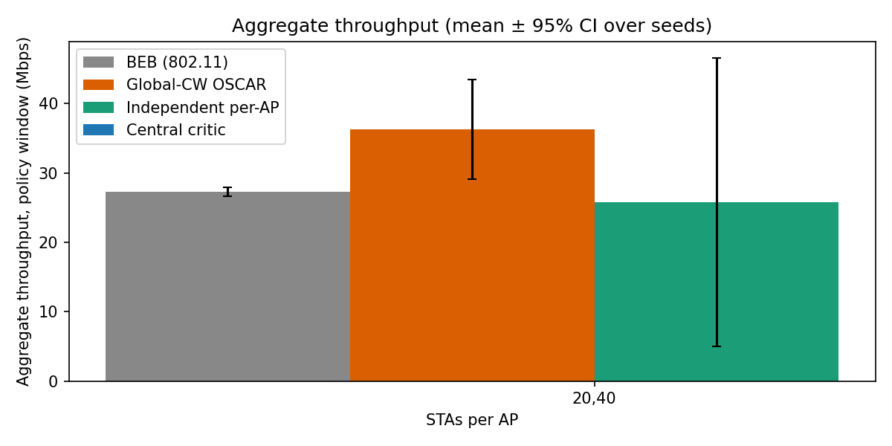
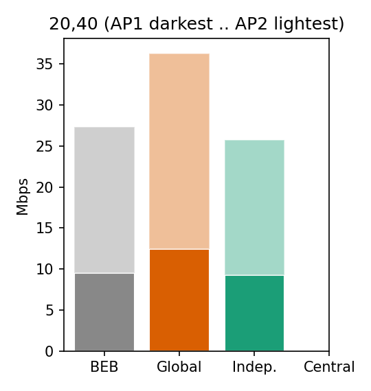
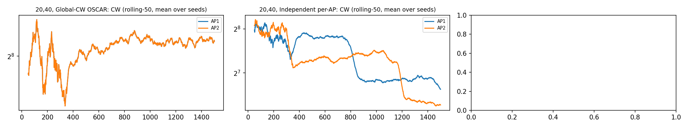
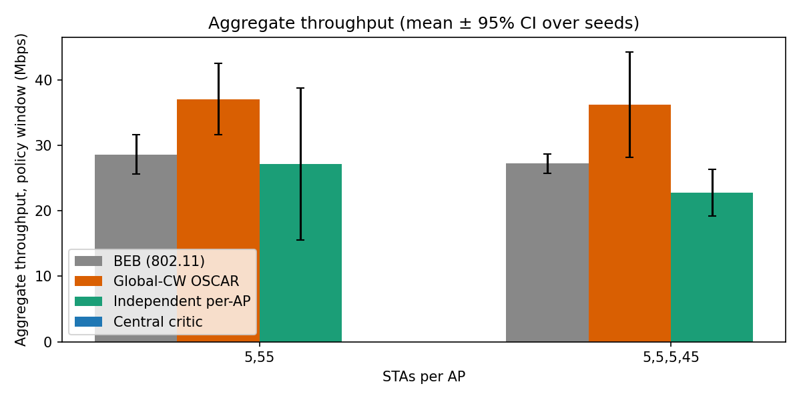
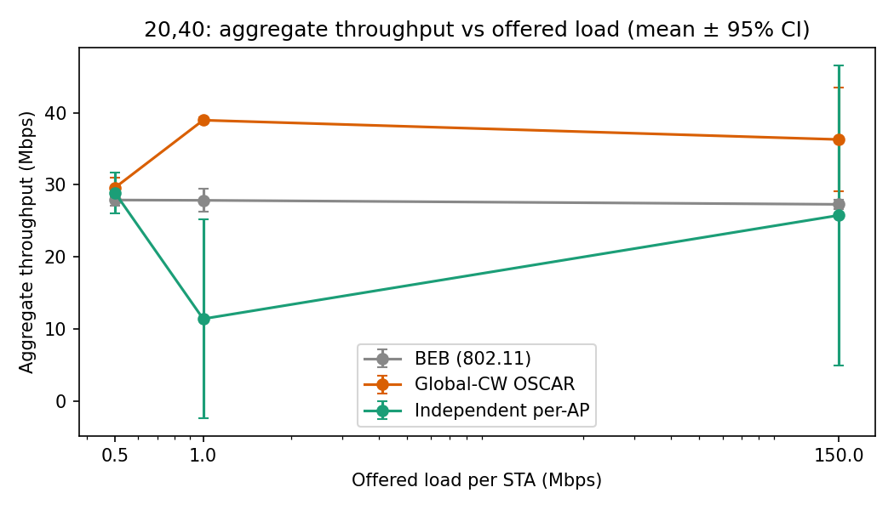
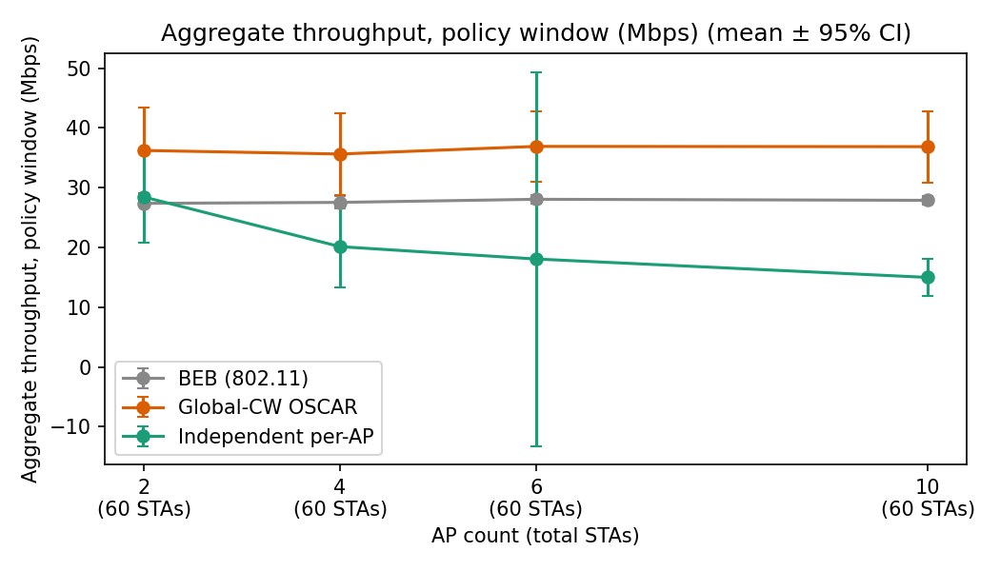
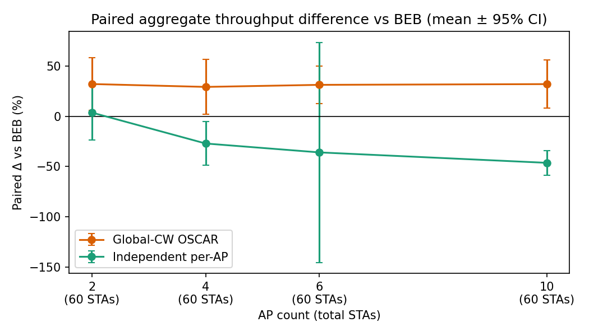
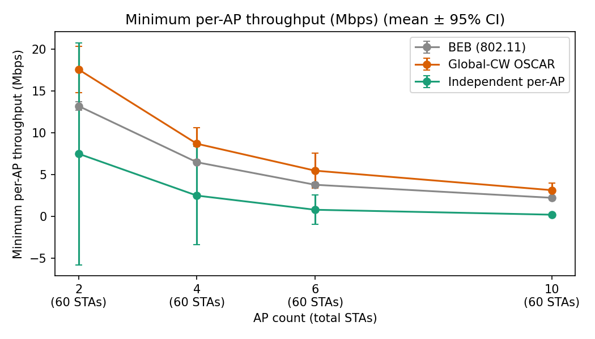
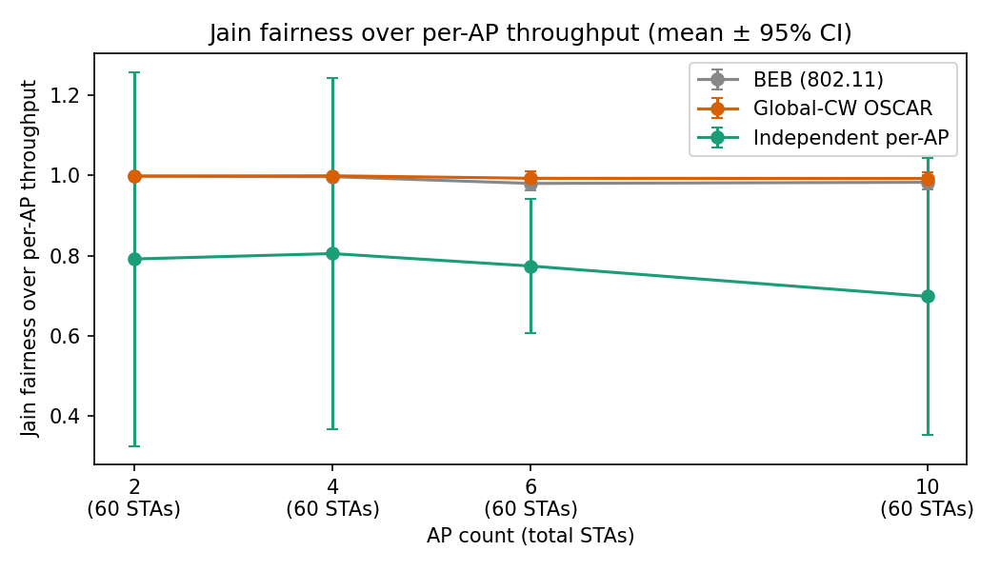

# Multi-AP OSCAR: Contention-Window Optimization with Per-AP DDPG Agents in a Shared ns-3 Simulation

Technical report, v2.3.0. Status: draft for review. Citations are placeholders written `[REF:key]`; see §26.

Labels used throughout: **[Inherited]** = comes from the original OSCAR design or code; **[New]** = added by this project; **[Upstream]** = ns-3 / ns3-gym code used unchanged. Statements are fact unless marked *inference* (reasoned, untested).

---

## 1. Abstract

OSCAR optimizes the IEEE 802.11 contention window (CW) of one access point (AP) with a DDPG actor-critic agent. This project extends it to N APs in one shared ns-3 simulation, each AP with its own independent DDPG agent and its own CW. We compare three controllers against standard 802.11 binary exponential backoff (BEB): independent per-AP agents, one shared "global-CW" agent whose CW is broadcast to every AP, and (as an appendix, negative result) a central-critic variant.

On the final, fixed-binary set (n = 3 seeds, 95 % confidence intervals), the global-CW agent gains +29.5 % to +33.2 % aggregate throughput over BEB in every saturated topology, from 2 to 10 APs at a fixed 60 stations. The independent per-AP agents do not scale: they are on par with BEB at N = 2 (+3.8 ± 27.2 %), then fall below it from N = 4 (−27.0 ± 21.8 %) to N = 10 (−46.2 ± 12.2 %). At a light load of 0.5 Mbps per station the global gain shrinks to +6.3 ± 8.0 %. The central critic did not help and is reported as a negative result. Results have wide intervals at n = 3, and several effects are explained only by inference.

## 2. Introduction

In 802.11 DCF, stations pick a random backoff in a window [0, CW]. A small CW wastes airtime in collisions when many stations contend; a large CW wastes airtime idling. BEB doubles CW after a loss and resets it after a success, which is not throughput-optimal in dense networks. OSCAR [REF:oscar] learns a CW with deep reinforcement learning to raise throughput.

The original design controls one AP's BSS. Real deployments have many neighbouring APs sharing a channel. This project asks whether per-AP learners, each seeing only local information, can coordinate implicitly, and how that behaviour changes as APs are added.

## 3. Problem Statement

Given N APs on one shared channel, each serving its own stations, choose each AP's CW to maximize network throughput, where every AP's learner observes only its own BSS. The difficulty is that each AP's CW changes the environment of the others, so independent learners face a non-stationary problem.

## 4. Objectives

1. Build one ns-3 simulation containing N APs, with per-AP statistics, per-AP CW control and a multi-AP ns3-gym interface. [New]
2. Train one DDPG agent per AP with strict isolation of observations, rewards, actions and statistics. [New]
3. Provide baselines: BEB and a centralized single-agent baseline (`global`). Per-AP OSCAR is the `independent` mode. [New]
4. Evaluate from 2 to 10 APs and under load and imbalance changes, with multiple seeds and confidence intervals. [New]
5. Specify, prototype and evaluate an optional central critic without letting it block the core. [New]

Out of scope (design contract, ADR-0002): mobility, dynamic stations, detailed interference modelling, per-station actors, PHY/MAC changes.

## 5. Background

An 802.11ax (HE) network in a single 5 GHz channel is simulated in ns-3.29 [REF:ns3]. Stations send UDP uplink traffic to their associated AP. A frame lost to collision is retransmitted with a larger CW. The learning loop is a Gym interface to ns-3 (ns3-gym [REF:ns3gym]): every `stepTime` of simulated time the simulator pauses, sends an observation and reward to Python, and applies the returned action.

## 6. IEEE 802.11 Contention Window

Under BEB the CW starts at 16 (`CWmin`) and doubles per failed attempt up to 1024 (`CWmax`). Every run here uses the range 16..1024 [REF:ieee80211]. In the agent modes the agent sets this value directly (§13), and the same clamp applies. In `beb` mode the ns-3 default DCF is used with no agent (`--dryRun`).

## 7. Original OSCAR [Inherited]

OSCAR is an AP-level DDPG agent that sets one CW for the AP's stations, from a loss-based observation, with a throughput-oriented reward and 10 ms decision epochs [REF:oscar]. The v0.1.0 baseline freeze (`docs/baseline-v0.1.0.md`) records what the code does, which differs from the paper in places. Differences measured in the code (code is authoritative over the paper):

| Item | This codebase | Note |
|---|---|---|
| Hidden layers (actor, critic) | 128, 128 | matches paper |
| Critic learning rate (Adam) | 4e-3 | matches paper |
| Actor learning rate (Adam) | 4e-4 | paper: 3e-4 |
| Discount / soft-update τ | 0.7 / 1e-3 | |
| State actually used | 1 scalar of the 300-value loss history | largest modelling gap versus the paper |
| Single-AP reward normalization | hard-coded `5 · 150` | not N-generic |
| Known quirks | uninitialized `jain_index()` in `cw.cc`; CW 0/0 until the first action | `baseline-v0.1.0.md` §7 |

Both the single-AP path and the original agent classes (`agents/our_ddpg/Our_DDPG.py`) are reused unchanged by the multi-AP trainer. [Inherited]

## 8. Related Work

Supporting literature on DRL/MARL-based CW optimization (not this project's architecture; `docs/project_description.md` §15):

- OSCAR [REF:oscar]: the project baseline (AP-level DDPG, loss observation, throughput reward).
- SETL-DQN(MA) [REF:setl]: cooperative multi-agent CW optimization with station-level agents and local observations, common throughput reward, Dec-POMDP framing.
- Adaptive Throughput Optimization [REF:ato]: distributed CW optimization with independent node-level agents.
- LILD-DQN [REF:lild]: collision/loss information as an RL observation.
- PDCF-DRL [REF:pdcf]: AP-level DRL agent adjusting CW from collision history.

These papers show that DRL/MARL CW control is feasible. None of them establishes the architecture used here (per-AP actors in one shared simulation, with a global-CW baseline and an optional shared critic). Station-level agents in some of them are not adopted here.

## 9. Proposed Multi-AP Architecture [New]

One ns-3 process contains N APs and all their stations. A Python trainer owns one DDPG agent per AP (actor and critic together are one agent). Each step the trainer reads N local observations, produces N actions, and ns-3 applies one CW per AP.

```text
 one ns-3 process (shared channel)           Python trainer
 +-----------------------------------+      +-----------------------------+
 | AP1 + STAs1  --loss_1, reward_1-->|----->| agent 1 (actor+critic) -> a1|
 | AP2 + STAs2  --loss_2, reward_2-->|----->| agent 2 (actor+critic) -> a2|
 | ...                               |      | ...                         |
 | APN + STAsN  --loss_N, reward_N-->|----->| agent N (actor+critic) -> aN|
 |        ^                          |      +--------------+--------------+
 |        +---- CW_1 .. CW_N ----------<-------------------+  (ns3-gym, ZMQ)
 +-----------------------------------+
```

Design contract: ADR-0002 and `docs/multi-ap-design-v0.2.0.md`. Invariants: per-AP isolation (no agent sees another AP's observation), local critics only in the core, sequential joint stepping, central critic optional and never blocking.

## 10. System Design

| Item | Value |
|---|---|
| Topology | N BSSs, one SSID per AP, fixed positions (`ConstantPositionMobilityModel`), shared channel |
| Traffic | UDP uplink STA → associated AP, constant rate, 1464-byte payload |
| Default stations | 20 + 40 (AP1 + AP2); scaling uses an equal split of 60 |
| Stepping | 1 step = 0.01 s simulated; 1500 steps = 15 s per run |
| Interface | multi-AP ns3-gym: observation Box [N, H], action Box [N] |
| Modes | `beb`, `independent`, `global`, `central` (appendix) |

## 11. RL Formulation

Per AP *i* (mode `independent`): a single-agent MDP with state = AP *i*'s latest loss ratio, action = a scalar in [−1, 1] mapped to AP *i*'s CW, reward = AP *i*'s normalized goodput. The joint problem is a multi-agent game in which each agent treats the others as part of the environment. Algorithm: DDPG [REF:ddpg] with actor/critic of 128-128 hidden units [Inherited]. Hyper-parameters (code defaults of `OSCAR_multi_ap_train.py`): batch 32, discount 0.7, τ = 1e-3, exploration noise σ = 0.1, 300 random-action warm-up steps, actor/critic lr 4e-4 / 4e-3.

## 12. Observation

[New, AP-local; the scalar is Inherited in kind] Each AP's observation is its latest loss ratio

`loss_i = (tx_i − rx_i) / tx_i`

over the last step, from AP *i*'s PHY transmit count and AP *i*'s sink receive count (0 if nothing was sent). The environment delivers a 300-step history per AP, but the agents use only the newest value (`state_dim = 1`), as in the original code. A richer state (windowed mean/std) exists in `preprocessor.py` but is not used here. In `global` mode the single agent sees one network-level loss scalar.

## 13. Action / CW Mapping

The actor outputs `a ∈ [−1, 1]` (Gaussian exploration noise added, then clipped). The trainer maps it to an exponent `e = 6 (a + 1) / 2 ∈ [0, 6]`, and `cw.cc` sets `CW = clamp(2^(4+e), 16, 1024)` per AP. [Inherited mapping, applied per AP by the project.] The first 300 steps use uniform random actions. From the v2.0.0 fix, agent runs start with CW 16/1024 instead of 0/0 until the first action (see §15).

## 14. Reward

[New in this form] Per AP: `reward_i = clamp(goodput_i / (offered_load · stas_i · step), 0, 1)`, i.e. received payload bits of AP *i*'s sink normalized by what its stations offer. In `global` mode the reward is the network goodput normalized by the offered load of all stations. Because the offered load saturates the channel, the policy-phase reward is small (about 0.003–0.004 at 60 STAs); this is a known scale (`docs/core-v1.0.0.md` §5), and the effect on learning is *inference* (untested). Reward plots (`reward.png`) are comparable within a figure only.

## 15. ns-3 Implementation

Project code, all under `ns-3.29/scratch/linear-mesh/` ([Upstream] ns-3.29 and `contrib/opengym` are used as-is; `git log` shows `ns-3.29/src` and `contrib/opengym` touched only by one commit, bc6f12c, and by no later commit):

- `scenario.h`, `cw.cc`: N-AP topology, per-AP counters, per-AP CW setting with readback, per-AP reward and loss, the multi-AP gym interface.
- PHY/MAC: 802.11ax 5 GHz, HE MCS 11, 20 MHz channel width, 800 ns guard interval, constant-rate station manager. [Inherited baseline settings, unchanged]
- Seeds: ns-3 seed = Python seed + 1; a bug where `--seed` did not affect ns-3 was fixed in v1.1.0 (commit 0e71414).
- **Bug found and fixed (v2.0.0, commit 1306e37):** agent modes began with CW 0/0, which starved most stations during warm-up. Multi-AP agent runs now begin at 16/1024. All v1.1.0–v1.9.0 agent results were produced before this fix and are treated as pre-fix (appendix only). Only the 81 v2.0.0 `*-cwfix` runs are used for conclusions.
- Association: with traffic starting at t = 0, large-N runs show late association and deassociation bursts; `--trafficStart=2` removed them in a diagnostic run (`docs/robustness-v2.0.0.md` §G). The final set keeps the inherited t = 0 start; dry BEB checks of its topologies (20,40, 6 x 10, 5,5,5,45) show every STA associated by 1.12 s, before the policy window (`docs/robustness-v2.0.0.md` §G.5).

## 16. Multi-Agent Architecture

| Mode | Agents | Observation | Action | Reward | Status |
|---|---|---|---|---|---|
| `beb` | none | none | standard BEB | none | baseline |
| `global` | 1 (shared) | network loss | one CW broadcast to all APs | network goodput | baseline B [New] |
| `independent` | N (one per AP) | own AP loss | own CW | own AP goodput | core [New] |
| `central` | N actors + 1 shared critic (CTDE) | own AP loss (actors); joint (critic) | own CW | global goodput | optional, appendix A |

`global` mode is a centralized single-agent baseline (one agent, one CW broadcast to all APs; not original OSCAR, whose per-AP deployment is `independent`); it uses global information and is therefore not an isolated-AP method. It is the reference for how much a shared signal helps.

## 17. W&B Experiment Tracking

Each run logs per-AP and global metrics (names from design §7) to Weights & Biases, offline by default. Since v2.1.0 runs are named `<topology> <mode> s<seed>` with mode and git-revision tags. Fact: the 81 final runs were produced before this naming and are stored as local offline `.wandb` files. Update 2026-10-20: all 81 were synced online to project `contention_window` (private) and renamed `<topology> <mode> s<seed>` with tags `multi-ap`, `final-v2.2.0`, `bench-<set>`, `mode-<mode>` (`docs/final-results-v2.2.0.md` §5). The committed record is the aggregated tables, CSVs and plots under `docs/figures/v2.2.0/`.

## 18. Experimental Setup

| Parameter | Value |
|---|---|
| Run length | 15 s simulated, step 0.01 s, 1500 steps |
| Policy window | steps ≥ 300 (after warm-up) |
| Seeds | 0, 1, 2 (n = 3 per cell); ns-3 seed = Python seed + 1 |
| Statistics | mean ± 95 % CI (Student t); paired difference vs BEB uses the same ns-3 seed |
| Offered load | 150 Mbps per station (saturated) unless stated |
| Binary | fixed (v2.0.0 `*-cwfix`), 81 runs, all PASS, no `cw.cc` change in v2.1–v2.2 |

Experiments:

| # | Experiment | Runs |
|---|---|---|
| 1 | Main comparison, 20,40 stations at 150 Mbps | 9 |
| 2 | Scaling at a fixed 60 stations, N = 2, 4, 6, 10 (equal split) | 36 |
| 3 | AP imbalance: 5,55 and 5,5,5,45 | 18 |
| 4 | Offered load 0.5 / 1 / 150 Mbps at 20,40 | 18 (+ #1) |

## 19. Baselines

- **BEB (802.11):** ns-3 default DCF, CW 16..1024, no agent.
- **Global-CW baseline (centralized single agent; earlier drafts and tables called it "Global-CW OSCAR", a mislabel):** one DDPG agent, one CW for all APs (§16).
- **Independent per-AP DDPG:** the proposed core method.

## 20. Results

Aggregate throughput in Mbps, mean ± 95 % CI over 3 seeds. Source: `docs/figures/v2.2.0/*/tables.md`.

### 20.1 Main comparison, 20,40 at 150 Mbps

| Mode | Aggregate | AP1 / AP2 | Jain | Phy loss | Paired vs BEB |
|---|---|---|---|---|---|
| BEB | 27.30 ± 0.63 | 9.48 / 17.82 | 0.913 | 0.747 | n/a |
| Global-CW | 36.29 ± 7.16 | 12.49 / 23.81 | 0.911 | 0.624 | +33.0 ± 29.0 % |
| Independent | 25.78 ± 20.80 | 9.26 / 16.52 | 0.837 | 0.765 | −5.6 ± 76.0 % |





### 20.2 Imbalance

| Topology | BEB | Global | Global vs BEB | Independent | Independent vs BEB |
|---|---|---|---|---|---|
| 5,55 | 28.64 ± 3.03 | 37.07 ± 5.45 | +29.7 ± 29.5 % | 27.14 ± 11.62 | −5.4 ± 36.2 % |
| 5,5,5,45 | 27.25 ± 1.47 | 36.28 ± 8.05 | +33.2 ± 29.3 % | 22.81 ± 3.55 | −16.2 ± 17.3 % |



### 20.3 Offered load, 20,40

| Load / STA (Mbps) | BEB | Global | Independent | Global vs BEB | Independent vs BEB |
|---|---|---|---|---|---|
| 0.5 | 27.90 ± 0.85 | 29.64 ± 1.36 | 28.86 ± 2.84 | +6.3 ± 8.0 % | +3.5 ± 13.3 % |
| 1 | 27.86 ± 1.60 | 38.96 ± 0.40 | 11.43 ± 13.75 | +39.9 ± 8.3 % | −58.8 ± 50.3 % |
| 150 | 27.30 ± 0.63 | 36.29 ± 7.16 | 25.78 ± 20.80 | +33.0 ± 29.0 % | −5.6 ± 76.0 % |



## 21. Scaling Analysis

Total stations fixed at 60, equal split, N = 2, 4, 6, 10 (removes the confound of growing station count in the earlier v1.x sweep).

| N | BEB | Global | Global vs BEB | Independent | Independent vs BEB |
|---|---|---|---|---|---|
| 2 | 27.38 | 36.23 | +32.3 ± 26.3 % (3/3) | 28.44 | +3.8 ± 27.2 % |
| 4 | 27.55 | 35.64 | +29.5 ± 27.5 % (3/3) | 20.14 | −27.0 ± 21.8 % |
| 6 | 28.06 | 36.92 | +31.5 ± 18.9 % (3/3) | 18.07 | −35.8 ± 109.7 % |
| 10 | 27.89 | 36.87 | +32.2 ± 23.9 % (3/3) | 14.99 | −46.2 ± 12.2 % |






Full table (per-station, per-AP, minimum per-AP, Jain, convergence step, run time, deassociation counts): `docs/figures/v2.2.0/fixed60-scaling/scaling_table.md`. Run time is about linear in the number of stations, not APs.

## 22. Discussion

Facts:
- BEB is flat in N at a fixed total load (27.4–28.1 Mbps).
- The global-CW agent is above BEB in all 3 seeds at every N, with +29.5 % to +33.2 % in every saturated topology and at 1 Mbps; the paired confidence-interval lower bounds are close to 0.
- Independent agents are negative from N = 4 (the interval excludes 0 at N = 4 and N = 10). Under imbalance the intervals include 0. At 1 Mbps they are far below BEB.
- Independent per-AP throughput and reward drift down late in the 20,40 run (`reward.png`, `convergence.png`). Minimum per-AP throughput at N = 10 is 0.22 ± 0.05 Mbps against 2.24 ± 0.02 Mbps for BEB.

Inference (not tested):
- Independent learners face a non-stationary environment because every other AP's CW changes the contention each agent sees; this may explain the decay with N.
- A weak learning signal (small, saturated reward) may contribute to modest and uneven gains.
- The global agent benefits from a signal that reflects the whole network; it does not respect the per-AP isolation rule, so the comparison shows an upper reference, not a deployable method.

## 23. Limitations

- n = 3 per cell; most agent-versus-BEB intervals are wide and several include 0.
- Active sinks were measured only at 20,40 / 150 Mbps, seed 0: 19/20 and 39/40 in BEB, global and independent alike, so inactive stations do not explain the agent gain there (`robustness-v2.0.0.md` §F.5, n = 1). Other topologies were not measured.
- Traffic starts at t = 0 (inherited), which causes late association at 220 STAs (not seen in the final-set topologies, §G.5 of the robustness doc, dry BEB, n=1); the final set was not rerun with `--trafficStart`.
- Observation is one loss scalar; the 300-value history is unused.
- Reward scale is small in saturation.
- Pre-fix (CW 0/0) results for v1.x and the central critic are not comparable to the final set.
- Raw traces and `.wandb` files are local only, so regeneration needs the local run directories.
- A single channel, fixed positions, uplink UDP only; no mobility and no dynamic stations.

## 24. Future Work

1. Find why the central critic collapsed at N = 10 (cause untested); rerun it on the fixed binary.
2. Rerun the final set with traffic started after association.
3. Measure active-sink counts for other topologies and seeds (only 20,40 seed 0 is done).
4. Richer state (windowed statistics), reward shaping that uses more of [0, 1], and more seeds.
5. Sync the final W&B runs.
6. Neighbourhood information sharing between APs as a middle point between independent and global.

## 25. Conclusion

The project delivers a working multi-AP OSCAR in one ns-3 process with strictly isolated per-AP DDPG agents, per-AP statistics and CW control, baselines, and a reproducible benchmark pipeline. Under saturation a single shared CW agent beats BEB by about 30 % at every tested size, while isolated per-AP agents match BEB at two APs and degrade as APs are added. Learning to coordinate through local loss alone is therefore not sufficient in this setup. The central critic prototype did not change that conclusion, and the open causes are listed in §23–24.

## 26. References

Fill in (user to supply full entries):

- [REF:oscar] OSCAR paper.
- [REF:setl] SETL-DQN(MA) paper.
- [REF:ato] Adaptive Throughput Optimization paper.
- [REF:lild] LILD-DQN paper.
- [REF:pdcf] PDCF-DRL paper.
- [REF:ddpg] DDPG (Lillicrap et al.).
- [REF:ns3] ns-3 simulator, version 3.29.
- [REF:ns3gym] ns3-gym.
- [REF:ieee80211] IEEE 802.11 standard.
- [REF:wandb] Weights & Biases.

---

## Appendix A. Central critic (negative, pre-fix)

Spec: `docs/central-critic-v1.7.0.md`, ADR-0003. Prototype: `--mode central` (N local actors, one shared critic on the global reward, joint replay). Evaluation (`docs/central-eval-v1.9.0.md`, n = 3, on the pre-fix binary): at N = 4 central 38.96 ± 5.11 vs independent 23.27 ± 13.19 (paired +72.5 ± 82.4 %, interval includes 0); at N = 10 central 3.20 ± 4.91 vs independent 9.00 ± 6.16 (paired −59.4 ± 71.5 %, interval includes 0), and −83 % against BEB. At N = 10 it collapsed after step ~300 (cause untested). The pre-agreed rule (beneficial only if the paired interval excludes 0 at N = 10) was not met; it stays optional and was excluded from the final set. Because the numbers predate the CW-start fix, they are not directly comparable to §20–21.

## Appendix B. Reproducing the results

From `ns-3.29/scratch/linear-mesh`, with `../../venv/bin/python` and the local run directories; commands are in `docs/final-results-v2.2.0.md` §4 (`aggregate_bench.py`, `scaling_analysis.py --preset fixed60`, `load_sweep.py`). Reproducibility checks (identical traces across repeated runs, seed sensitivity) are in `docs/reproducibility-v2.1.0.md`. Build and run: `cd ns-3.29 && ./waf build --target=linear-mesh`; training entry point `OSCAR_multi_ap_train.py --apStaCounts 20,40 --mode {beb,global,independent}`.

## Appendix C. Version history

v0.1 baseline freeze → v0.2 design → v0.3 two-AP topology → v0.4 per-AP statistics → v0.5 per-AP CW → v0.6 multi-AP ns3-gym → v0.7 independent agents → v0.8 W&B → v0.9 validation → v1.0 core → v1.1–v1.6 benchmarks and 2→10 AP scaling (pre-fix) → v1.7–v1.9 central critic (spec, prototype, evaluation) → v2.0 robustness and CW-start fix → v2.1 reproducibility → v2.2 final results → v2.3 this report.
